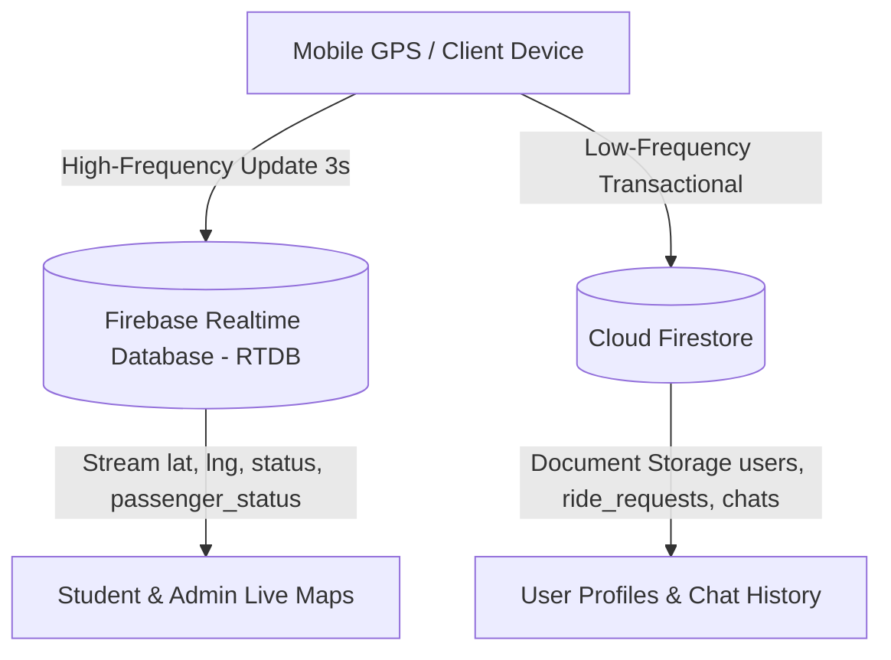
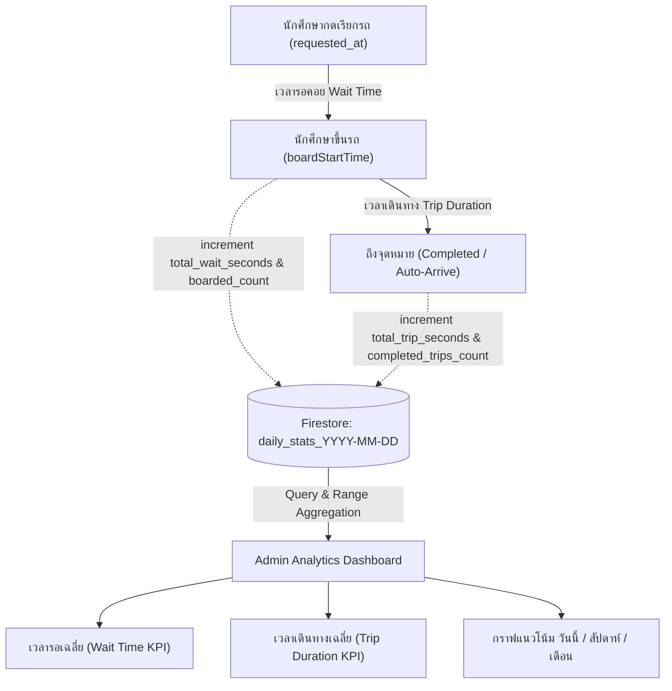

# 📝 PSRU Shuttle App - Detailed System & Feature Documentation (Changelog)

เอกสารฉบับนี้รวบรวมรายละเอียดของระบบ ทั้งในส่วนของฟีเจอร์ โครงสร้างสถาปัตยกรรม (Architecture), ฐานข้อมูล (Database), ลอจิกอัลกอริทึมทางคณิตศาสตร์ (Mathematical Algorithms) และระบบซิงก์ข้อมูลแบบ Real-time ของแอปพลิเคชัน **PSRU Shuttle App** ไว้อย่างสมบูรณ์

---

## 🆕 อัปเดตล่าสุด (Recent Updates)

### 2026-09-09 — แก้เส้นไฮไลท์เมื่อรถข้ามป้าย 5 (ยังไม่ deploy)

- แก้กรณีนักศึกษาเดินทางจากป้าย 4 ไปป้าย 6 แล้วรถเลี้ยวข้ามป้าย 5 (ศูนย์กีฬาในร่ม): ระบบเดิมบังคับ waypoint ผ่านป้าย 5 แม้รถเลี้ยวไปป้าย 6 แล้ว ทำให้เส้นย้อนกลับและ ETA เกินจริง
- เพิ่ม `StopFiveBypass` ให้แยกทางเข้าป้าย 5 กับทางไปป้าย 6 จาก graph ถนนเดิม ใช้เฉพาะเมื่อรถผ่านป้าย 4 และต้องมีหลักฐานการเคลื่อนที่ต่อเนื่องหลังพ้นแยกก่อนยืนยันการข้าม ตำแหน่งซ้ำหรือ GPS แกว่งใกล้แยกไม่เพียงพอ
- เชื่อมกับ `_updateRouteAndETA()` ในหน้านักศึกษาจริง เมื่อยืนยันแล้วให้เริ่มเส้นทางที่ป้าย 6 และคำนวณจำนวนป้าย/ETA ใหม่ ส่วนรถที่เข้าป้าย 5 ยังใช้เส้นทางผ่านป้าย 5
- จำผลแยกตามรถและล้างเมื่อรถพ้นช่วงหรือ offline ป้องกันเส้นสลับกลับไปป้าย 5 หรือเอาผลจากรอบเก่ามาใช้ คำขอที่มีปลายทางป้าย 5 ยังคงปลายทางเดิม และไม่เปลี่ยน `last_passed_stop` หรือแจ้งถึงปลายทางจากการข้ามป้าย
- ทดสอบ unit tests 10 กรณี และ replay 9 assertions ด้วยบล็อก graph/waypoint จากหน้าจอจริงร่วมกับ `route_data.dart` และพิกัดป้าย 4/5/6 ที่อ่านจากฐานข้อมูลจริง โดยไม่แก้ข้อมูล Firebase ดู [วิธีทดสอบ](tools/routing-tests/README.md)
- ยังไม่ได้ deploy หรือทดสอบขับรถจริง ควรตรวจทั้งเที่ยวที่แวะป้าย 5 และเที่ยวที่เลี้ยวตรงไปป้าย 6 บนอุปกรณ์จริง

### Version 1.0.5 (Security Hardening, Routing & Real-time Sync Stability Update)

**อัปเดตความปลอดภัย สถาปัตยกรรมการนำทาง และความเสถียรของระบบ Real-time (แก้ไขข้อบกพร่องตาม Code Review ครบทั้ง 9 ข้อ)**

- **Security & Permissions Hardening (ข้อ 1):** ปรับปรุงกฎความปลอดภัย Realtime Database (`database.rules.json`) ให้จำกัดสิทธิ์การเขียนและอัปเดตตำแหน่ง GPS เฉพาะคนขับที่ได้รับมอบหมายรถคันนั้น หรือผู้ดูแลระบบ (Admin) เท่านั้น พร้อมชุดทดสอบอัตโนมัติ 12 กรณี
- **Driver Shuttle Reassignment Sync (ข้อ 2):** เมื่อคนขับเปลี่ยนรถในหน้าแก้ไขโปรไฟล์ ระบบจะปลดสิทธิ์คนขับออกจากเอกสารรถเดิมใน Firestore และผูกเข้ากับรถคันใหม่อย่างสมบูรณ์ พร้อมให้หน้าหลักคนขับรีเฟรชข้อมูลและเชื่อมต่อ RTDB node คันใหม่แบบเรียลไทม์
- **Attribute Casing Compatibility (ข้อ 3):** รองรับชื่อฟิลด์ข้อมูลรถทั้งรูปแบบ `shuttle_name`/`shuttle_number` และ `shuttleName`/`shuttleNumber` ครอบคลุมทุกหน้าจอของแอดมินและคนขับ ป้องกันปัญหาข้อมูลตกหล่น
- **Role-Based Admin Routing (ข้อ 4):** ปรับปรุงการนำทางใน `main.dart`, `splash_screen.dart`, และ `login_screen.dart` ให้ตรวจสอบ Role `admin` จากฐานข้อมูล Firestore โดยตรงและนำทางไปยัง `/adminDashboard` โดยไม่ต้องพึ่งพาอีเมลพิเศษ
- **Locked Target Tracking & Resync (ข้อ 5):** ขณะนักศึกษารอรถ (`isWaiting`) ระบบจะล็อกการคำนวณเส้นทางและเวลา ETA ไว้กับรถคันเป้าหมายเดิม ไม่สลับคันไปมาตามระยะทาง และหากรถคันเดิมออฟไลน์ จะสลับไปหารถคันใหม่พร้อมอัปเดต `target_shuttle_id` ใน Firestore ทันที
- **Stationary Vehicle Online Recovery (ข้อ 6):** เพิ่มการดักฟัง `.info/connected` และปรับปรุง Heartbeat ทุก 30 วินาที เพื่อคืนสถานะ `online` และลงทะเบียน `onDisconnect` ต่อเนื่อง ป้องกันรถที่จอดนิ่งค้างสถานะ `offline` หลังเน็ตกลับมา
- **Student Active Ride Recovery (ข้อ 7):** เพิ่มระบบกู้คืนคำขอเรียกรถเดิมเมื่อเปิดแอปใหม่หรือรีเฟรชหน้าจอ (อายุไม่เกิน 2 ชั่วโมง) พร้อมเชื่อมต่อ Stream ติดตามสถานะและเปิดให้กดยกเลิกหรือเสร็จสิ้นการเดินทางได้ตามปกติ
- **Midnight Chat Room Rollover (ข้อ 8):** เพิ่มระบบตรวจจับวันปัจจุบันในห้องแชทของทั้งนักศึกษาและคนขับ โดยมี Timer ตรวจสอบทุกนาทีและตรวจซ้ำก่อนส่งข้อความ เพื่อสลับไปห้องของวันใหม่ (`${baseRoom}_$todayDate`) อัตโนมัติเมื่อข้ามเที่ยงคืน
- **Inactive Stops Filtering (ข้อ 9):** กรองข้ามจุดจอดที่ถูกปิดให้บริการ (`is_active == false`) ไม่นำมาแสดงบนแผนที่ และเพิ่มการตรวจสอบก่อนส่งคำขอเรียกรถ เพื่อป้องกันการเรียกรถที่ป้ายปิดบริการ

---

#### รายการประเด็นจากการรีวิว (สถานะการแก้ไขครบถ้วน)

| ข้อ | ระดับ | ประเด็นและผลกระทบ | โค้ดที่เกี่ยวข้อง | สถานะ ณ วันที่บันทึก |
| --- | --- | --- | --- | --- |
| 1 | P1 | ผู้ใช้ที่ล็อกอินทุกคนเขียนหรือลบข้อมูลรถทุกคันได้ เพราะกฎเดิมอนุญาตเขียนที่ระดับ `shuttles` ด้วย `auth != null` | `database.rules.json` | แก้ในโค้ดและผ่าน Emulator แล้ว; รอตั้งค่าสิทธิ์บัญชีเดิมและ deploy |
| 2 | P2 | คนขับเปลี่ยนรถในโปรไฟล์ แต่ระบบยังส่ง GPS และรับคำขอของรถเดิม เนื่องจากบันทึกเฉพาะ `users` ขณะที่หน้าคนขับเลือกรถจาก `shuttles.driver_uid` ก่อน | `driver_edit_profile_screen.dart`, `driver_home.dart` | แก้ไขเรียบร้อยแล้ว |
| 3 | P2 | แอดมินเขียน `shuttleName/shuttleNumber` แต่ฝั่งคนขับอ่าน `shuttle_name/shuttle_number` ทำให้ข้อมูลรถไม่แสดงและการตรวจรถซ้ำมองข้ามบัญชีเหล่านี้ | `add_driver_dialog.dart`, `edit_driver_dialog.dart`, `admin_drivers_tab.dart`, `driver_profile.dart`, `driver_edit_profile_screen.dart`, `driver_home.dart` | แก้ไขเรียบร้อยแล้ว |
| 4 | P2 | บัญชี role admin ที่อีเมลไม่ตรงค่าพิเศษในโค้ดเข้าแอดมินผ่าน Google login ได้ แต่เปิดแอปใหม่แล้วถูกส่งไปหน้านักศึกษา เพราะการเลือกหน้าตาม role ไม่สอดคล้องกัน | `main.dart`, `login_screen.dart`, `splash_screen.dart` | แก้ไขเรียบร้อยแล้ว |
| 5 | P1 | ระหว่างรอรถ หน้านักศึกษาอาจเปลี่ยนไปติดตามคัน B แต่ `target_shuttle_id` ในคำขอยังเป็นคัน A ทำให้ ETA/แชทไม่ตรงกับคนขับที่ได้รับคำขอ | `student_home.dart`, `driver_home.dart` | แก้ไขเรียบร้อยแล้ว |
| 6 | P2 | รถที่จอดนิ่งอาจคงสถานะ offline หลังเน็ตกลับมา เพราะ onDisconnect ตั้ง offline แต่ heartbeat อัปเดตเฉพาะเวลา และการคืน online ผูกกับการเคลื่อนที่ตาม GPS | `driver_home.dart` | แก้ไขเรียบร้อยแล้ว |
| 7 | P2 | รีเฟรชหรือเปิดแอปใหม่แล้วไม่กู้คืนคำขอรถเดิม นักศึกษาจึงติดตามหรือยกเลิกไม่ได้ ทั้งที่คนขับยังเห็นคำขอ | `student_home.dart` | แก้ไขเรียบร้อยแล้ว |
| 8 | P2 | เปิดแชทข้ามเที่ยงคืนแล้วส่งข้อความเข้าห้องวันใหม่ แต่หน้าจอยังฟังห้องวันเก่า ทำให้ข้อความใหม่ไม่ปรากฏ | `student_chat_screen.dart`, `driver_chat_screen.dart` | แก้ไขเรียบร้อยแล้ว |
| 9 | P2 | แอดมินปิดให้บริการป้ายด้วย `is_active` แต่หน้านักศึกษาและคนขับไม่ตรวจค่านี้ จึงยังแสดงและเรียกรถที่ป้ายปิดได้ | `student_home.dart`, `driver_home.dart` | แก้ไขเรียบร้อยแล้ว |

ผลรีวิวอ้างอิงโค้ดและ rules ใน repository ไม่ได้ยืนยัน rules ที่ deploy จริงหรือทดสอบกับ Firebase production

#### การแก้ไขข้อ 1 — จำกัดสิทธิ์เขียนรถรายคัน

- เปลี่ยน `database.rules.json` ให้ผู้ใช้ที่ล็อกอินอ่านตำแหน่งรถได้ แต่เขียนได้เฉพาะแอดมินหรือคนขับที่ได้รับมอบหมายรถคันนั้น
- แยกรายการแอดมินไว้ที่ `/access/admins/<UID>` ซึ่งตั้งค่าได้ผ่านผู้ดูแล Firebase เท่านั้น และรายการคนขับที่ได้รับมอบหมายไว้ที่ `/shuttle_drivers/<RTDB_KEY>` ซึ่งแอดมินเป็นผู้จัดการ
- ไม่ใช้ `users.role`, อีเมล หรือ `driver_uid` ในข้อมูลรถเป็นหลักฐานสิทธิ์เพียงอย่างเดียว ป้องกันการปลอมเจ้าของรถและการให้สิทธิ์ตนเอง
- คนขับสร้างข้อมูลรถที่ได้รับมอบหมายครั้งแรกและอัปเดต GPS/สถานะได้ แต่ลบรถหรือถอด/เปลี่ยน `driver_uid` เป็นคนอื่นไม่ได้ เพิ่มการตรวจชนิดและช่วงค่าพิกัด รวมถึงสถานะ online/offline
- เพิ่ม `lib/services/shuttle_access.dart` เพื่อใช้คีย์รถร่วมกันและจัดการมอบหมาย/ถอนสิทธิ์ เชื่อมกับหน้าสร้างและแก้ไขคนขับของแอดมิน
- ถอนสิทธิ์เดิมก่อนแก้ข้อมูลคนขับ และใช้ transaction ป้องกันการทับสิทธิ์รถของคนอื่น หากบันทึกข้าม Firestore/RTDB ล้มเหลว จะปฏิเสธสิทธิ์ไว้ก่อนและให้แอดมินตรวจสอบแล้วบันทึกใหม่
- ยกเลิกการลบ node รถเก่าอัตโนมัติจากแอปคนขับ และปิด Firebase app ชั่วคราวหลังขั้นตอนสร้างบัญชีแม้เกิดข้อผิดพลาด

#### การแก้ไขข้อ 2 — การซิงก์ข้อมูลรถของคนขับเมื่อเปลี่ยนรถในโปรไฟล์

- แก้ไข `driver_edit_profile_screen.dart`: เมื่อคนขับแก้ไขข้อมูลรถในโปรไฟล์ ระบบจะลบการผูกสิทธิ์ (`driver_uid`, `driver_name`, `driver_avatar`) ออกจากเอกสารรถคันเดิมใน Firestore และบันทึกข้อมูลคนขับลงในเอกสารรถคันใหม่อย่างสมบูรณ์
- แก้ไข `driver_home.dart`: เพิ่ม Stream listener คอยตรวจสอบการเปลี่ยนแปลงของข้อมูลรถในเอกสาร `users` ของคนขับ หากพบว่ามีการเปลี่ยนคันรถ ระบบจะเรียก `_fetchDriverShuttle()` เพื่อรีเฟรชข้อมูลและเชื่อมต่อ RTDB node คันใหม่อัตโนมัติ รวมถึงตรวจสอบการสลับแท็บกลับจากหน้าโปรไฟล์

#### การแก้ไขข้อ 3 — ความเข้ากันได้ของชื่อฟิลด์ข้อมูลรถ (camelCase vs snake_case)

- ฝั่งแอดมิน (`add_driver_dialog.dart`, `edit_driver_dialog.dart`, `admin_drivers_tab.dart`): รองรับทั้ง `shuttle_name`/`shuttle_number` และ `shuttleName`/`shuttleNumber` โดยบันทึกทั้งสองรูปแบบลงในเอกสารเพื่อความเข้ากันได้แบบ 100%
- ฝั่งคนขับ (`driver_profile.dart`, `driver_edit_profile_screen.dart`, `driver_home.dart`): ปรับให้อ่านข้อมูลสลับฟิลด์ได้ทั้งสองแบบ (`data['shuttle_name'] ?? data['shuttleName']`) ครอบคลุมการแสดงผล, การตรวจสอบรถซ้ำ, และการคำนวณ Key ประจำรถ

#### การแก้ไขข้อ 4 — การเลือกหน้าจอตาม Role แอดมิน (Admin Routing)

- แก้ไข `main.dart`, `splash_screen.dart`, และ `login_screen.dart`: ปรับลอจิกการตรวจสอบ Role ให้ตรวจสอบ `role == 'admin'` จากเอกสาร Firestore `users` โดยตรง หากเป็นแอดมินจะนำทางไปยัง `/adminDashboard` ทันที ป้องกันปัญหาบัญชีแอดมินที่ไม่ได้ฮาร์ดโค้ดอีเมลหลุดเข้าไปยังหน้านักศึกษา

#### การแก้ไขข้อ 5 — ล็อกการติดตามรถระหว่างรอ และซิงก์คันเป้าหมายไปยัง Firestore

- แก้ไข `student_home.dart` (`_updateRouteAndETA`): เพิ่มเงื่อนไข `isWaiting` ร่วมกับ `isAcknowledged` และ `isOnBoard` เพื่อล็อกการคำนวณเส้นทาง ไฮไลต์ และ ETA ให้อยู่กับรถคันที่ได้รับมอบหมาย ไม่สลับคันไปมาตามระยะทาง
- หากรถคันที่ติดตามเกิดออฟไลน์ระหว่างรอ ระบบจะสลับไปค้นหารถคันที่ใกล้ที่สุดคันใหม่ พร้อมอัปเดต `target_shuttle_id` ใน Firestore `ride_requests` ทันที เพื่อให้คนขับคันใหม่มองเห็นคำขอได้อย่างถูกต้อง

#### การแก้ไขข้อ 6 — การกู้คืนสถานะออนไลน์ของรถที่จอดนิ่งหลังเชื่อมต่อใหม่

- แก้ไข `driver_home.dart`: เพิ่ม `_listenToConnectionStatus` ฟังสถานะ `.info/connected` ของ Firebase Realtime Database เมื่อเชื่อมต่อสำเร็จและคนขับออนไลน์อยู่ ระบบจะอัปเดตสถานะเป็น `online` และลงทะเบียน `onDisconnect().set('offline')` ทันที
- ปรับปรุง `_heartbeatTimer` (ทำงานทุก 30 วินาที) ให้อัปเดตสถานะเป็น `online` ควบคู่กับเวลาล่าสุด และต่ออายุ `onDisconnect().set('offline')` สม่ำเสมอ แม้รถจะจอดนิ่งโดยที่ไม่มีการส่งพิกัด GPS ใหม่

#### การแก้ไขข้อ 7 — การกู้คืนคำขอเรียกรถเดิมเมื่อเปิดแอปใหม่ (Active Ride Recovery)

- แก้ไข `student_home.dart`: เพิ่มฟังก์ชัน `_restoreActiveRequest()` ใน `initState` เพื่อค้นหาคำขอของนักศึกษาที่มีสถานะ `waiting`, `acknowledged`, หรือ `on_board` ใน Firestore `ride_requests` ที่ไม่เกิน 2 ชั่วโมง
- หากพบคำขอค้างอยู่ ระบบจะกู้คืนสถานะ ป้ายที่รอ ป้ายลงรถ รถเป้าหมาย และผูก `requestSubscription` ผ่านฟังก์ชันกลาง `_listenToRideRequest()` เพื่อติดตามสถานะแบบ Real-time และสามารถกดยกเลิกหรือเสร็จสิ้นการเดินทางได้ตามปกติ

#### การแก้ไขข้อ 8 — การรีเฟรชห้องแชทอัตโนมัติเมื่อข้ามเที่ยงคืน (Midnight Chat Rollover)

- แก้ไข `student_chat_screen.dart` และ `driver_chat_screen.dart`: เพิ่มฟังก์ชัน `_checkAndRefreshRoomIfNeeded()` เพื่อเปรียบเทียบห้องแชทปัจจุบันกับห้องของวันที่ปัจจุบัน (`${baseRoom}_$todayDate`)
- เพิ่ม Timer ตรวจสอบวันที่ทุกๆ 1 นาที และตรวจสอบก่อนส่งข้อความทุกครั้ง หากข้ามเที่ยงคืนระบบจะสลับไปฟัง Stream ข้อความของวันใหม่ทันที ทำให้ข้อความที่ส่งและรับไม่สูญหายหรือตกค้างในห้องของวันเก่า

#### การแก้ไขข้อ 9 — การกรองจุดจอดที่ปิดให้บริการ (Inactive Stops Filtering)

- แก้ไข `student_home.dart` และ `driver_home.dart` (`_fetchStopsFromFirebase`): เพิ่มเงื่อนไขกรองข้ามจุดจอดที่ถูกปิดให้บริการ (`data['is_active'] == false`) ออกจากการโหลดป้าย
- แก้ไข `student_home.dart` (`_toggleWaitState`): เพิ่มการตรวจสอบความพร้อมของป้ายต้นทางและปลายทางก่อนส่งคำขอเรียกรถ หากป้ายถูกปิดให้บริการ ระบบจะแสดงการแจ้งเตือนและไม่อนุญาตให้ส่งคำขอ

ผลรีวิวอ้างอิงโค้ดและ rules ใน repository ไม่ได้ยืนยัน rules ที่ deploy จริงหรือทดสอบกับ Firebase production

#### การแก้ไขข้อ 1 — จำกัดสิทธิ์เขียนรถรายคัน

- เปลี่ยน `database.rules.json` ให้ผู้ใช้ที่ล็อกอินอ่านตำแหน่งรถได้ แต่เขียนได้เฉพาะแอดมินหรือคนขับที่ได้รับมอบหมายรถคันนั้น
- แยกรายการแอดมินไว้ที่ `/access/admins/<UID>` ซึ่งตั้งค่าได้ผ่านผู้ดูแล Firebase เท่านั้น และรายการคนขับที่ได้รับมอบหมายไว้ที่ `/shuttle_drivers/<RTDB_KEY>` ซึ่งแอดมินเป็นผู้จัดการ
- ไม่ใช้ `users.role`, อีเมล หรือ `driver_uid` ในข้อมูลรถเป็นหลักฐานสิทธิ์เพียงอย่างเดียว ป้องกันการปลอมเจ้าของรถและการให้สิทธิ์ตนเอง
- คนขับสร้างข้อมูลรถที่ได้รับมอบหมายครั้งแรกและอัปเดต GPS/สถานะได้ แต่ลบรถหรือถอด/เปลี่ยน `driver_uid` เป็นคนอื่นไม่ได้ เพิ่มการตรวจชนิดและช่วงค่าพิกัด รวมถึงสถานะ online/offline
- เพิ่ม `lib/services/shuttle_access.dart` เพื่อใช้คีย์รถร่วมกันและจัดการมอบหมาย/ถอนสิทธิ์ เชื่อมกับหน้าสร้างและแก้ไขคนขับของแอดมิน
- ถอนสิทธิ์เดิมก่อนแก้ข้อมูลคนขับ และใช้ transaction ป้องกันการทับสิทธิ์รถของคนอื่น หากบันทึกข้าม Firestore/RTDB ล้มเหลว จะปฏิเสธสิทธิ์ไว้ก่อนและให้แอดมินตรวจสอบแล้วบันทึกใหม่
- ยกเลิกการลบ node รถเก่าอัตโนมัติจากแอปคนขับ และปิด Firebase app ชั่วคราวหลังขั้นตอนสร้างบัญชีแม้เกิดข้อผิดพลาด

#### ผลการตรวจสอบ

- ทำ regression test กับกฎเดิมแล้วพบว่าการเขียนที่ควรถูกปฏิเสธกลับสำเร็จ ยืนยันช่องโหว่ก่อนแก้ไข
- หลังแก้ไข ทดสอบ Firebase Database Emulator ผ่าน **12 กรณี** ครอบคลุมนักศึกษา ผู้ไม่ล็อกอิน เจ้าของรถ คนขับคันอื่น แอดมิน การปลอมเจ้าของ การเพิ่มสิทธิ์ตนเอง การเขียนหลาย path ธุรกรรมมอบหมาย/ถอนสิทธิ์ การตรวจข้อมูล และ `onDisconnect`
- ตรวจ Dart analyzer ใน service และหน้าจอที่แก้ไข ไม่พบ errors; ยังมี warnings เดิมเรื่อง field ที่ไม่ได้ใช้งาน 2 จุดใน `driver_home.dart` รวมถึง lint เดิม
- ตรวจ diff ของไฟล์ที่แก้ไขแล้วไม่พบปัญหา whitespace
- ชุดทดสอบและวิธีรัน: [tools/security-tests/README.md](tools/security-tests/README.md)

#### สิ่งที่ต้องทำก่อนใช้งานจริง

**ยังไม่ได้ deploy กฎหรือเปลี่ยนข้อมูล production** ต้องตรวจสอบ UID แอดมินและมอบหมายสิทธิ์ให้คนขับเดิมก่อนเปิดใช้กฎใหม่ มิฉะนั้นคนขับที่ยังไม่มีสิทธิ์จะเขียนข้อมูลรถไม่ได้ จากนั้นแจกจ่ายแอปเวอร์ชันนี้ให้แอดมินก่อนเพิ่มหรือเปลี่ยนคนขับครั้งต่อไป ดูขั้นตอนใน [คู่มือตั้งค่าสิทธิ์ฐานข้อมูล](docs/database-access.md)

การแก้ข้อ 1 ไม่ได้แก้ข้อ 2–9 และไม่ได้เปลี่ยน Firestore rules หรือระบบเลือก role ตอน login

---

### Version 1.0.4 (Analytics Intelligence & Journey Metrics Update)
**อัปเดตระบบวิเคราะห์ข้อมูลขั้นสูง (Admin Analytics Intelligence & Multi-Period Aggregation)**
- **ระบบสลับช่วงเวลาการวิเคราะห์ (Period Switcher - วันนี้ / สัปดาห์ / เดือน):**
  - เพิ่มปุ่มเลือกช่วงเวลาแบบ Modern Capsule Segmented Pill Switcher ที่ส่วนบนสุดของหน้าแท็บ Analytics
  - รองรับการดูสถิติ 3 ช่วงเวลา: **"วันนี้" (Today)**, **"สัปดาห์นี้" (This Week: จันทร์ - อาทิตย์)**, และ **"เดือนนี้" (This Month: วันที่ 1 ถึงสิ้นเดือน)**
  - ระบบประมวลผลข้อมูลอัจฉริยะแบบช่วงเวลา (Range Aggregation Query) โดยใช้ `FieldPath.documentId` ดึงช่วงเอกสาร `daily_stats_YYYY-MM-DD` จาก Cloud Firestore เพื่อรวบรวมสถิติทั้งสัปดาห์และทั้งเดือนได้อย่างรวดเร็วและประหยัดโควต้าการอ่าน
- **ระบบติดตามตัวชี้วัดเวลาเฉลี่ย (Average Wait Time & Trip Duration KPIs):**
  - **เวลารอรถเฉลี่ย (Average Wait Time):** คำนวณจากระยะเวลาตั้งแต่ "นักศึกษากดเรียกรถ" จนถึง "นักศึกษากดขึ้นรถ" (`total_wait_seconds / boarded_count`) แสดงผลในรูปแบบนาทีและวินาที พร้อมการ์ดแสดงสถานะ เช่น "รวดเร็วมาก"
  - **เวลาเดินทางเฉลี่ย (Average Trip Duration):** คำนวณจากระยะเวลาตั้งแต่ "นักศึกษาขึ้นรถ" จนถึง "รถถึงจุดหมายปลายทาง" (`total_trip_seconds / completed_trips_count`) แสดงผลในรูปแบบนาทีและวินาที พร้อมป้ายสถานะประเมินความคล่องตัว
- **กราฟแนวโน้มไดนามิกตามช่วงเวลา (Adaptive Trend Line & Distribution Chart):**
  - ปรับเปลี่ยนการแสดงผลกราฟตามช่วงเวลาที่เลือกโดยอัตโนมัติ:
    - **วันนี้:** กราฟการกระจายตัวของผู้โดยสารรายชั่วโมง (07:00 - 18:00) และระบุชั่วโมงเร่งด่วน (Peak Hour)
    - **สัปดาห์นี้:** กราฟแนวโน้มจำนวนผู้โดยสารรายวัน ตั้งแต่วันจันทร์ (จ.) ถึงวันอาทิตย์ (อา.)
    - **เดือนนี้:** กราฟแนวโน้มจำนวนผู้โดยสารรวมแบ่งตามช่วง 4 สัปดาห์ของเดือน
- **วงแหวนวัดประสิทธิภาพการเดินรถ (Operational Fleet Efficiency Ring):**
  - แสดงผลสัดส่วนประสิทธิภาพการให้บริการเป็นเปอร์เซ็นต์ด้วย Custom Circular Progress Ring สีเขียวมินต์ พร้อมการวิเคราะห์สถานะเชิงเปรียบเทียบ
- **การจัดอันดับ 5 จุดจอดที่มีการใช้งานสูงสุด (Dynamic Top 5 Popular Stops):**
  - รวบรวมข้อมูลสถิติการขึ้นรถจากทุกจุดจอดตามช่วงเวลาที่เลือก และจัดอันดับ 5 ป้ายยอดนิยมแบบ Real-time พร้อมแถบ Progress Bar สีเขียวไล่ระดับ

**อัปเดตระบบติดตามการเดินทางฝั่งนักศึกษา (Student Journey Duration Tracking)**
- **การจับเวลาการเดินทางจริง (Live Trip Timer):** บันทึกเวลาเริ่มต้นเมื่อนักศึกษาขึ้นรถ (`boardStartTime`) เมื่อสถานะเปลี่ยนเป็น `on_board`
- **ระบบส่งสถิติเวลาอัตโนมัติ (`_recordTripTimeAnalytics`):** คำนวณเวลาเดินทางจริง (`tripSeconds`) แล้วส่งอัปเดตแบบ `FieldValue.increment` ไปยัง Firestore `analytics/daily_stats_YYYY-MM-DD` ในฟิลด์ `total_trip_seconds` และ `completed_trips_count`
- **รองรับทั้งสองกรณี:** บันทึกข้อมูลทั้งเมื่อนักศึกษากดปุ่ม "ถึงจุดหมายแล้ว" (`_completeRide`) ด้วยตนเอง และเมื่อระบบตัดจบการเดินทางอัตโนมัติ (`_handleAutoArrive`) เมื่อรถเข้าใกล้ป้ายปลายทางในรัศมี 15 เมตร

**การแก้ไขข้อผิดพลาดระบบและเพิ่มความเสถียร (Bug Fixes & System Stability)**
- **อัปเดตโลโก้แอปพลิเคชันฝั่งผู้ดูแลระบบ (Admin Logo Update):** เปลี่ยนโลโก้หลักในแถบเมนูข้าง (`AdminSidebar`) จากภาพเดิมเป็นภาพโลโก้ใหม่ `assets/images/LOGO02.png` (PSRU S² Tracker) ซึ่งแสดงผลครอบคลุมทุกหน้าจอของระบบแอดมิน (ภาพรวมระบบ, แผนที่ติดตามสด, จัดการคนขับรถ, จัดการนักศึกษา, รายงานและสถิติ รวมถึงเมนูด้านข้างบนมือถือ)
- **อัปเดตโลโก้แอปพลิเคชันฝั่งนักศึกษา (Student App Logo Update):** เปลี่ยนโลโก้หลักของฝั่งนักศึกษาเป็นภาพโลโก้ใหม่ `assets/images/LOGO02.png` (PSRU S² Tracker) ครบทุกหน้าจอ ได้แก่ หน้าหลักและแผนที่สด (`student_home.dart`), หน้ารายการแชท (`student_chat_list_screen.dart`), หน้าสรุปสถานะรถสด (`student_live_status_screen.dart`), หน้าโปรไฟล์นักศึกษา (`student_profile.dart`), และหน้าแนะนำการใช้งานเริ่มต้น (`student_onboarding_screen.dart`)
- **อัปเดตโลโก้หน้าเริ่มต้นแอปพลิเคชัน (Splash Screen Logo Update):** เปลี่ยนโลโก้บนหน้าโหลดเปิดแอป (`splash_screen.dart`) เป็นภาพโลโก้แนวตั้งทรงกลม `assets/images/LOGO01.png` (PSRU S² Tracker Badge) พร้อมปรับขนาดความสูงและการจัดวางในกรอบการ์ดให้สมดุลและสวยงามคมชัด
- **ระบบหน้าจอโหลดกลางแบบมีแบรนด์ (Standardized Branded Loading Screen with `AppLoadingView`):**
  - สร้างคอมโพเนนต์มาตรฐาน `AppLoadingView` (`lib/widgets/app_loading_view.dart`) ที่นำภาพโลโก้ใหม่ `assets/images/LOGO02.png` (PSRU S² Tracker) มาแสดงผลร่วมกับหลอดความคืบหน้า (`LinearProgressIndicator`) สีเขียวมหาวิทยาลัย (`#176a21`) และข้อความแจ้งเตือนสถานะภาษาไทยอย่างสวยงามลงตัว
  - ปรับใช้แทนที่วงล้อหมุนธรรมดา (Default `CircularProgressIndicator`) ในทุกหน้าจอขณะกำลังโหลดข้อมูล (In-App Loading States):
    - **ฝั่งนักศึกษา:** หน้าหลักแผนที่สด (`student_home.dart`), หน้ารายการแชท (`student_chat_list_screen.dart`), หน้าสรุปสถานะรถสด (`student_live_status_screen.dart`), หน้าโปรไฟล์นักศึกษา (`student_profile.dart`), หน้าแก้ไขโปรไฟล์ (`student_edit_profile_screen.dart`), หน้ารายการจุดจอดที่ชอบ (`favorite_stops_screen.dart`), และหน้าห้องแชทนักศึกษา (`student_chat_screen.dart`)
    - **ฝั่งคนขับรถ:** หน้าสถานะรถรับส่ง (`driver_status_screen.dart`), หน้าโปรไฟล์คนขับ (`driver_profile.dart`), หน้าแก้ไขโปรไฟล์ (`driver_edit_profile_screen.dart`), และหน้าห้องแชทคนขับ (`driver_chat_screen.dart`)
    - **ฝั่งผู้ดูแลระบบ:** หน้าวิเคราะห์ข้อมูลและสถิติ (`admin_analytics_tab.dart`), หน้าจัดการนักศึกษา (`admin_students_tab.dart`), หน้าจัดการคนขับรถ (`admin_drivers_tab.dart`), และหน้าต่างโปรไฟล์แอดมิน (`admin_profile_dialog.dart`)
- **อัปเดตโลโก้แอปพลิเคชันฝั่งคนขับรถและหน้าเข้าสู่ระบบ (Driver App & Login Logo Update):** เปลี่ยนภาพโลโก้เดิม (`lib/screens/driver/logo.png`) เป็นภาพโลโก้ใหม่ `assets/images/LOGO02.png` (PSRU S² Tracker) ครบทุกหน้าจอของฝั่งคนขับรถ ได้แก่ หน้าหลักคนขับ (`driver_home.dart`), หน้าสถานะรถรับส่ง (`driver_status_screen.dart`), หน้าโปรไฟล์คนขับ (`driver_profile.dart`), รวมถึงหน้าจอเข้าสู่ระบบ (`login_screen.dart`) และลบการอ้างอิงไฟล์โลโก้เดิมออกทั้งหมด
- **ล็อกขอบเขตแผนที่เฉพาะพื้นที่มหาวิทยาลัยราชภัฏพิบูลสงคราม (Campus Map Boundary Lock - Student & Driver Apps):**
  - **ฝั่งนักศึกษา (`student_home.dart`):** ปรับปรุงขอบเขตพิกัดแผนที่ (`_psruBounds` และ `_psruCameraBounds`) ให้กระชับตามแนวเขตที่ดินของมหาวิทยาลัยราชภัฏพิบูลสงคราม (ทะเลแก้ว) ครอบคลุมบึงทะเลแก้ว, กลุ่มอาคารเรียน, หอพัก, สนามกีฬา และเส้นทางเดินรถรับส่งทั้งหมด (ทิศใต้ 16.82300, ทิศเหนือ 16.83800, ทิศตะวันตก 100.20300, ทิศตะวันออก 100.21800)
  - **ฝั่งคนขับรถ (`driver_home.dart`):** ล็อกขอบเขตแผนที่และมุมกล้อง (`_psruBounds` และ `_psruCameraBounds`) สอดคล้องกับฝั่งนักศึกษา โดยใช้ `CameraConstraint.containCenter(bounds: _psruCameraBounds)` ป้องกันไม่ให้แผนที่เลื่อนหลุดออกนอก ม. พร้อมตั้ง `minZoom` 15.8, `maxZoom` 18.5, และ `initialZoom` 16.2/16.5
  - **การตรวจจับพิกัด GPS อัจฉริยะ:** เพิ่มการตรวจสอบ `_psruBounds.contains` ทั้งตอนเปิดแอป, ตอนรับพิกัดสด, และตอนกดปุ่มติดตามตำแหน่งรถ (Recenter Floating Action Button) หากพิกัดอยู่นอกเขตมหาวิทยาลัย กล้องจะขยับมาตั้งหลักที่จุดกึ่งกลางของมหาวิทยาลัย (`_psruCenter`) และแจ้งเตือนผ่าน TopToast อย่างชัดเจน
- **แก้ไข Flutter 3.27+ Framework Assertion Error ใน `admin_dashboard.dart`:** แก้ไขปัญหาระบบแจ้งเตือน `ListTile background color or ink splashes may be invisible` โดยนำวิดเจ็ต `Material` มาครอบ `ListTile` ใน `_buildNavItem` และย้ายสีพื้นหลังพร้อมขอบมนไปกำหนดที่ `Material` เพื่อให้การตอบสนองการกด (Ink Splash Ripple Effect) ทำงานได้อย่างถูกต้องและเสถียรบนทุกแพลตฟอร์ม
- **ปรับปรุงข้อความระบุข้อมูลกองรถใน `admin_live_map.dart`:** ปรับปรุง Label และการจัดรูปแบบการแสดงผลข้อมูลกองรถให้ชัดเจนและเป็นระเบียบยิ่งขึ้น

### Version 1.0.3
- **Web App Deployment**: บิลด์และดีพลอยแอปพลิเคชันขึ้น Firebase Hosting (ปัจจุบันสถานะคือ Disable ชั่วคราว)
- **Android APK Build**: บิลด์และส่งออกไฟล์ติดตั้งแอปพลิเคชันสำหรับระบบ Android (`app-release.apk`) ขนาดไฟล์ 67.2MB
- อัปเดตเวอร์ชันแอปพลิเคชันใน pubspec.yaml เป็น `1.0.3`

**อัปเดตระบบแจ้งเตือน (In-App Notifications & Real-Time Sync)**
- **ยกเลิกการใช้ Firebase Cloud Messaging (FCM) & Push Notifications:** ปิดการใช้งานระบบ Push Notification (FCM) แบบเดิมที่เคยทำงานร่วมกับ Cloud Functions ทั้งหมด เพื่อลดความซับซ้อนของโครงสร้างระบบ และหลีกเลี่ยงปัญหาความเข้ากันได้ (Compatibility) บน Web Browser / PWA
- **เปลี่ยนกลับมาใช้ In-App Real-Time Notifications:** ใช้ระบบ Stream (Listen) จาก Cloud Firestore และ Realtime Database แทน เพื่อสร้างการแจ้งเตือนแบบ In-App (Custom Floating Popup / Top Toast) ลอยขึ้นมาบนหน้าจอขณะที่ใช้งานแอปอยู่ ซึ่งตอบสนองได้รวดเร็วกว่าและทำงานได้เสถียรบนทุกแพลตฟอร์ม
- **การแจ้งเตือนเสียงข้ามสิทธิ์:** ยังคงรักษาฟีเจอร์การแจ้งเตือนด้วยเสียง (Sound Alerts & TTS) สำหรับการเรียกรถ การตอบรับ และแชทใหม่ ไว้ได้อย่างสมบูรณ์ผ่านการทำงานเบื้องหน้า (Foreground)

**อัปเดตระบบเส้นทางและ GPS (Routing & GPS Optimization)**
- **Robust Coordinate Parsing:** อัปเดตระบบดึงข้อมูลพิกัด (lat/lng) จาก Firestore ในหน้า student_home.dart และ driver_home.dart ให้สามารถแปลงชนิดข้อมูล (Type Casting) จาก String เป็น double ได้อย่างปลอดภัย ป้องกันปัญหาแอปแครชเงียบ (Silent Crash) ที่ทำให้แผนที่ว่างเปล่า (หมุดไม่โหลด)
- **Animated Map Movement:** เพิ่มระบบแอนิเมชันตอนเลื่อนแผนที่ (Pan/Zoom) ในฝั่งแอดมิน (dmin_live_map.dart) ให้การเคลื่อนกล้องไปหาเป้าหมายมีความนุ่มนวล (Smooth Curve) มากขึ้น
- **Smart Hybrid Routing (Driver App):** ปรับจูนระบบฝั่งคนขับให้บังคับใช้ **Lookahead Window คาดการณ์ล่วงหน้า 3 ป้าย** เป็นหลัก พร้อมกำหนดกฎเหล็กให้ **Recovery Mode ห้ามกระโดดข้ามเกิน 3 ป้าย** (แก้ไขปัญหา GPS คลาดเคลื่อนแล้วทำให้สถานะกระโดดข้ามจากป้าย 12 ไป 18 ในบริเวณทางแยก)
- **Auto-Arrive System (Student App):** ปรับปรุงระบบปิดงานเรียกรถอัตโนมัติ โดยรถจะต้องเดินทางมาถึง "ป้ายเป้าหมายสุดท้ายจริง ๆ" (`stepCount == 0`) และมีระยะห่างน้อยกว่า 15 เมตรเท่านั้น ถึงจะปิดงาน ป้องกันระบบปิดงานก่อนกำหนดเมื่อรถขับผ่านป้ายเป้าหมายในรอบก่อนหน้า
- **Dijkstra Algorithm & Map Nodes:** แก้ไขการสร้างกราฟถนน (`_routeGraph`) ให้รองรับเส้นทางเดินรถแบบ One-Way และแก้ปัญหาคีย์พิกัดสูญหาย รวมถึงปรับพิกัดทางแยก (Segment 14, 15, 23) ใน `route_data.dart` ให้จุดตัดเชื่อมต่อกันอย่างสมบูรณ์แบบ
- **One-Way Route Fallback (Student App):** ดักจับเคสหาเส้นทางบนถนนเดินรถทางเดียว (One-Way) หากรถขับเลยป้ายและอัลกอริทึม (Dijkstra) ไม่สามารถลากเส้นย้อนศรได้ ระบบจะข้ามการลากเส้นตรงทะลุตึกเพื่อรออัปเดตพิกัดใหม่ ป้องกันแผนที่พัง
- **Stop Wrapping Logic:** ปรับจูนระบบกระโดดข้ามป้าย (Jump) ทั้งฝั่งคนขับและนักศึกษา กำหนดขีดจำกัดข้ามไปข้างหน้าสูงสุด 2 ป้าย / ย้อนหลังสูงสุด 1 ป้าย และบังคับการวนลูปจากป้าย 23 ไปยังป้าย 1 เท่านั้น (ห้ามข้ามไป 2 หรือ 3)
- **Firebase Realtime Database (RTDB):** เพิ่มการตั้งค่า `database.rules.json` สำหรับกำหนดสิทธิ์ความปลอดภัยให้รองรับการรับส่ง GPS สด
- **Login Navigation Fix:** แก้ไขบั๊กการเปลี่ยนหน้า (Redirect) ผิดพลาดใน `login_screen.dart` ที่ทำให้เด้งไปหน้าแชทผิดจังหวะ

**อัปเดตส่วนติดต่อผู้ใช้งาน (UI/UX Improvements)**
- **Login Screen UI Redesign:** ปรับปรุงโครงสร้างหน้าจอเข้าสู่ระบบ (login_screen.dart) ใหม่ โดยล็อกให้แบบฟอร์มอยู่กึ่งกลางหน้าจอแบบไม่เลื่อน (Fixed Center) และจะเลื่อนเฉพาะตอนที่คีย์บอร์ดถูกเปิดขึ้นมาเท่านั้น แก้ปัญหา Bottom Overflow และ Red Screen
- **Register Screen Enhancement:** ขยายขนาดตัวหนังสือในฟอร์มเป็น 18px พร้อมปรับแก้ไขโค้ดการเปลี่ยนหน้า (Routing) เพื่อแก้ปัญหาที่กดลิงก์ไปหน้าเข้าสู่ระบบแล้วกลายเป็นจอขาว (White Screen Bug)
- **Dynamic Shuttle Naming:** อัปเดตป๊อปอัปแจ้งเตือน (Top Toast) ให้แสดงชื่อและเบอร์รถ (เช่น `รถเบอร์ SH#01`) ที่นักศึกษากำลังสื่อสารด้วย แทนคำว่า "คันเป้าหมาย" เพื่อความชัดเจนและเจาะจง
- **Consistent Chat Popup Design:** ปรับดีไซน์ป๊อปอัปแจ้งเตือนแชทฝั่งนักศึกษา ให้เข้ากับฝั่งคนขับ (ใช้ไอคอนรูปโปรไฟล์วงกลม, เปลี่ยน Label เป็น "คนขับรถ", และทำปุ่มแชทสีขาวตัวอักษรเขียว)
- **Expandable Info Card (Student App):** เพิ่มฟีเจอร์ปุ่ม "ขยายการ์ดข้อมูล" เหนือปุ่มเป้าเล็ง GPS โดยจะแสดงขึ้นมาเฉพาะตอนที่นักศึกษาย่อการ์ดจุดหมายลงไป ทำให้สามารถเรียกการ์ดข้อมูลจุดจอดกลับมาดูแบบเต็มจอได้สะดวกยิ่งขึ้น

---

## 🚀 ฟีเจอร์ที่พัฒนาเสร็จแล้ว (Completed Features)

### 🔐 1. ระบบยืนยันตัวตนและจัดการสิทธิ์ (Authentication & Role Management)
- [x] **การเลือกสิทธิ์การใช้งาน (Multi-Role Signup):** แบ่งเป็นสิทธิ์นักศึกษา (`student`) และคนขับรถ (`driver`)
- [x] **การลงทะเบียนคนขับรถ:** สามารถเลือกรถรับส่งที่ตนเองรับผิดชอบ (เช่น `Shuttle #01`, `Shuttle #02`) พร้อมเลือกรูปโปรไฟล์ Avatar
- [x] **เชื่อมต่อ Firebase Authentication:** ตรวจสอบอีเมลและรหัสผ่าน ป้องกันการเข้าถึงหน้าจอที่ไม่ได้รับอนุญาต
- [x] **ระบบกู้คืนรหัสผ่าน (Forgot Password):** ส่งลิงก์รีเซ็ตรหัสผ่านไปยังอีเมลของผู้ใช้งาน
- [x] **จัดเก็บโปรไฟล์ใน Firestore:** บันทึกข้อมูลลงในคอลเล็กชัน `users`
- [x] **ระบบการออกจากระบบ (Logout):** ล้าง State และคืนสิทธิ์อย่างปลอดภัยทั้งบนแอปมือถือและเว็บ

### 🧑‍🎓 2. ฝั่งนักศึกษา (Student Portal)
- [x] **หน้าจอแนะนำการใช้งาน (Onboarding Screen):** หน้าต่างสอนวิธีใช้งานแอปพลิเคชันเบื้องต้นสำหรับนักศึกษาที่ล็อกอินครั้งแรก
- [x] **ระบบจัดการโปรไฟล์ (Edit Profile):** รองรับการเปลี่ยนรูปภาพ Avatar ประจำตัวผู้ใช้งาน
- [x] **แผนที่ติดตามรถแบบ Real-time (Live Map Tracking):** แสดงตำแหน่งรถทุกคันที่กำลังออนไลน์บน OpenStreetMap ด้วย `flutter_map`
- [x] **ระบบคำนวณเส้นทางไฮไลท์อัจฉริยะ (Smart Route Highlighting):** ลากเส้นสีเขียวเข้มไฮไลท์เส้นทางสั้นที่สุดจากจุดที่รถอยู่ไปยังป้ายที่เลือก
- [x] **ระบบเรียกรถรับส่ง (Ride Request):** นักศึกษากดเรียกรถล่วงหน้า คนขับจะได้รับเสียงเตือนและป๊อปอัปแจ้งเตือนบนหน้าจอทันที
- [x] **ระบบติดตามสถานะการขึ้นรถ (On-Board Tracking):** อัปเดตสถานะเป็น `acknowledged` -> `on_board` -> `completed`
- [x] **จุดจอดที่ชอบ (Favorite Stops):** ติดดาวป้ายรถเมล์ที่ใช้ประจำเพื่อจัดให้อยู่ด้านบนสุดของรายการ
- [x] **แชทกับคนขับรถ (Student-Driver Chat):** ส่งข้อความและรูปภาพสื่อสารกับคนขับประจำสายแบบ Real-time พร้อมป๊อปอัปแจ้งเตือนลอยด้านบน
- [x] **หน้าสรุปสถานะรถสด (Live Status Dashboard):** การ์ดแสดงจำนวนรถว่าง, รถเต็ม, พักเบรค, นอกเวลา แบบ 2x2 Grid ตอบสนองทุกขนาดหน้าจอ

### 🚌 3. ฝั่งคนขับรถ (Driver Portal)
- [x] **ระบบจัดการโปรไฟล์ (Edit Profile):** คนขับสามารถแก้ไขรูปภาพ Avatar ประจำตัวได้
- [x] **สวิตช์เปิด/ปิดสถานะวิ่งรถ (Online/Offline Toggle):** ซิงก์ตำแหน่ง GPS อัตโนมัติไปยัง Firebase Realtime Database (RTDB)
- [x] **ระบบล็อกหมุดบนถนน (Snap to Route Algorithm):** บังคับหมุดรถให้อยู่บนถนนจริงเสมอ ไม่ลอยเข้าไปในอาคาร
- [x] **การแจ้งเตือนเสียงจุดจอดอัตโนมัติ (TTS & Sound Alerts):** อ่านชื่อจุดจอดภาษาไทยทั้ง 21 ป้ายด้วยระบบ Text-to-Speech (`flutter_tts`) ร่วมกับเสียงเอฟเฟกต์ `chat_sound.mp3`, `glass_1.mp3`, `glass_2.mp3`
- [x] **ป๊อปอัปการ์ดแจ้งเตือนข้อความแชตใหม่ (Driver Chat Popup Card):** แสดงการ์ดลอยด้านบนเมื่อนักศึกษาทักแชต พร้อมปุ่มกดตอบกลับทันที
- [x] **สลับสถานะผู้โดยสาร (Passenger Status):** อัปเดตสถานะรถเป็น "รถว่าง", "รถเต็ม", "เวลาพักเบรค", "เลิกงาน"

### 👑 4. ฝั่งผู้ดูแลระบบ (Admin Master Dashboard)
- [x] **แดชบอร์ดสถิติ Real-Time (Live Analytics Dashboard):** คำนวณผู้โดยสารรวมประจำวัน, ชั่วโมงที่มีการใช้งานสูงสุด (Peak Hour), จำนวนเที่ยววิ่ง
- [x] **สวิตช์เลือกช่วงเวลาวิเคราะห์ข้อมูล (Period Switcher):** เลือกระหว่าง วันนี้ (Today), สัปดาห์นี้ (Week), เดือนนี้ (Month) พร้อมระบบ Aggregation ข้อมูลจาก Firestore อัตโนมัติ
- [x] **ตัวชี้วัดเวลารอรถและเวลาเดินทางเฉลี่ย (Wait & Trip Duration KPIs):** คำนวณเวลารอรถเฉลี่ย (ตั้งแต่เรียกจนขึ้นรถ) และเวลาเดินทางเฉลี่ย (ตั้งแต่ขึ้นรถจนถึงจุดหมาย) พร้อมการ์ดสรุปผลและระดับความเร็ว
- [x] **กราฟจำลองและแนวโน้มผู้โดยสาร (Adaptive Multi-Period Trend Chart):** แสดงชั่วโมงเร่งด่วนสำหรับ "วันนี้", แสดงแนวโน้มรายวัน (จ.-อา.) สำหรับ "สัปดาห์นี้", และแสดงแนวโน้มรายสัปดาห์ (สัปดาห์ 1-4) สำหรับ "เดือนนี้"
- [x] **วงแหวนวัดประสิทธิภาพการเดินรถ (Operational Fleet Efficiency Ring):** คำนวณสัดส่วนความตรงต่อเวลาและการให้บริการเป็นเปอร์เซ็นต์ พร้อมตัวชี้วัดเปรียบเทียบ
- [x] **การจัดอันดับ 5 จุดจอดรถยอดนิยม (Dynamic Top 5 Popular Stops):** รวบรวมยอดผู้โดยสารรายป้ายตามช่วงเวลาและจัดอันดับแบบไดนามิก
- [x] **แผนที่ติดตามกองรถสด (Admin Live Fleet Map):** ยุบกลุ่มป้ายที่อยู่ใกล้กัน (`_groupedStops`) และติดตามรถทุกคันพร้อมสถิติสด
- [x] **ระบบจัดการคนขับและนักศึกษา (User Management):** ค้นหา, กรองสถานะออนไลน์, เพิ่ม/แก้ไข/ลบ ข้อมูลสมาชิก

---

## 🧠 อธิบาย Logic และ Algorithm สำคัญ (Core Architecture & Mathematical Logic)

---

### 1. ⚡ สถาปัตยกรรมฐานข้อมูลแบบไฮบริด (Hybrid RTDB + Firestore Architecture)

> [!NOTE]
> เพื่อแก้ไขปัญหาความล่าช้า (Latency) และประหยัดโควต้าการอ่าน/เขียนของ Firebase (Quota & Cost Optimization) โปรเจกต์นี้จึงใช้สถาปัตยกรรมฐานข้อมูลแบบผสม 2 ชนิด:



1. **Firebase Realtime Database (RTDB) — โหนด `shuttles/{shuttle_id}`**:
   - ใช้สำหรับข้อมูลที่มีการอัปเดตความถี่สูงทุกๆ 3 วินาที ได้แก่ พิกัดละติจูด (`lat`), ลองจิจูด (`lng`), สถานะออนไลน์ (`status`), สถานะผู้โดยสาร (`passenger_status`) และเวลาล่าสุด (`last_updated`)
   - ช่วยให้หมุดรถลื่นไหลแบบ 60fps และไม่เสียโควต้า Document Reads/Writes ใน Firestore
2. **Cloud Firestore — คอลเล็กชัน `users`, `ride_requests`, `chats`, `stops`**:
   - ใช้สำหรับข้อมูลเชิงความสัมพันธ์ เช่น ประวัติคำขอเรียกรถ, บัญชีผู้ใช้, จุดจอดที่ชอบ และข้อความแชทสนทนา

> 💡 **สรุปแบบเข้าใจง่าย (สำหรับบุคคลทั่วไป / ไม่ใช่สายไอที):**  
> เปรียบเหมือน **"ระบบส่งข้อมูล 2 ช่องทาง (ช่องทางด่วน + ตู้เซฟหลัก)"**
> - **ช่องทางด่วน (Realtime DB):** เหมือนใช้วิทยุสื่อสารรายงานตำแหน่งรถสดๆ ทุก 3 วินาที ทำให้หมุดรถบนหน้าจอขยับลื่นไหล ไม่กระตุก และลื่นตามาก
> - **ตู้เซฟหลัก (Cloud Firestore):** เหมือนตู้เซฟเก็บประวัติสำคัญ เช่น ข้อมูลสมาชิกนักศึกษา ประวัติคำขอเรียกรถ และข้อความแชท เพื่อความปลอดภัยและประหยัดค่าบริการเซิร์ฟเวอร์

---

### 2. 📍 อัลกอริทึมล็อกหมุดบนถนน (Snap to Route Algorithm via Vector Orthogonal Projection)

> [!TIP]
> แก้ไขปัญหาสัญญาณ GPS คลาดเคลื่อน (GPS Drift) ที่ทำให้หมุดกระโดดเข้าไปในอาคารเรียน โดยการใช้หลักคณิตศาสตร์ **Vector Projection** บนเส้นทางถนน (`shuttleRoutes`)

$$t = \frac{\vec{AP} \cdot \vec{AB}}{|\vec{AB}|^2} = \frac{(p_x - a_x)(b_x - a_x) + (p_y - a_y)(b_y - a_y)}{(b_x - a_x)^2 + (b_y - a_y)^2}$$

1. **การหาจุดตั้งฉากบนส่วนของเส้นตรง (Segment Projection):**
   - ให้จุด $P = (p_x, p_y)$ เป็นพิกัด GPS ดิบจากมือถือคนขับ
   - ให้ $A = (a_x, a_y)$ และ $B = (b_x, b_y)$ เป็นจุดปลายของส่วนของเส้นตรงถนน (Polyline Segment)
   - คำนวณค่าสเกลาร์ $t$ (Normalized Projection Parameter) ผ่านผลคูณจุด (Dot Product) ตามสูตรด้านบน
2. **การบีบขอบเขตจุดฉาย (Clamping Bounds):**
   - ถ้า $t < 0 \implies C = A$ (ยึดจุดเริ่มต้น)
   - ถ้า $t > 1 \implies C = B$ (ยึดจุดปลาย)
   - ถ้า $0 \le t \le 1 \implies C = \left( a_x + t(b_x - a_x), \; a_y + t(b_y - a_y) \right)$ (จุดตั้งฉากบนถนน)
3. **การเลือกจุดที่ใกล้ที่สุดและการเคลื่อนไหวแบบนุ่มนวล (Minimum Distance & Smooth Interpolation):**
   - คำนวณระยะทางกำลังสอง $D^2 = (p_x - c_x)^2 + (p_y - c_y)^2$ เปรียบเทียบทุก Segment เพื่อเลือกจุด $C_{\text{min}}$ บนถนนที่ใกล้ที่สุด
   - เคลื่อนหมุดไปยังพิกัดใหม่ด้วย `AnimationController` (Duration 400ms) ร่วมกับ `Tween<LatLng>` และ `Curves.easeInOut` เพื่อให้หมุดเลื่อนตามโค้งถนนอย่างลื่นไหล

> 💡 **สรุปแบบเข้าใจง่าย (สำหรับบุคคลทั่วไป / ไม่ใช่สายไอที):**  
> เปรียบเหมือน **"แม่เหล็กดูดรถเข้าเส้นทางถนน"**
> - สัญญาณ GPS จากมือถือคนขับมักจะคลาดเคลื่อนเวลามีตึกบัง ทำให้หมุดรถชอบลอยหลุดเข้าไปในตึกเรียนหรือบนหลังคาอาคาร
> - ระบบนี้จะทำหน้าที่เป็นเหมือน **"แม่เหล็กคอยดูดตำแหน่งรถให้ตกลงบนเส้นทางถนนจริงเสมอ"** ไม่ว่ารถจะเลี้ยวโค้งหรือเข้าทางแยก หมุดรถก็จะวิ่งอยู่บนถนนอย่างสมจริง ไร้อาการหลุดเข้าไปในตึก

---

### 3. 🗺️ อัลกอริทึมคำนวณเส้นทางไฮไลท์และเวลาถึงป้าย (Smart Proximity Pathfinding & Dijkstra's ETA)

> [!IMPORTANT]
> ระบบคำนวณเส้นทางอัจฉริยะใน `student_home.dart` มีการตรวจสอบระยะทางตรงจริง (Direct Proximity Check) ร่วมกับ Dijkstra Algorithm เพื่อป้องกันการลากเส้นวนรอบมหาวิทยาลัย

1. **Smart Direct Proximity Check (ตรวจจับระยะประชิด):**
   - คำนวณระยะทางตรง $\text{Direct Distance}$ ระหว่างพิกัดรถใกล้ที่สุดกับป้ายเป้าหมาย
   - **กรณีระยะทาง $\le 80 \text{ เมตร}$:** ระบบจะเชื่อมเส้นไฮไลท์ไปยังป้ายทันที โดยไม่วนลูปป้าย 23 จุดรอบมหาวิทยาลัย พร้อมแสดง ETA ว่า **"รถกำลังจะถึงป้าย"**
2. **Dijkstra Shortest Path บนกราฟถนน (`_routeGraph`):**
   - **กรณีระยะทาง $> 80 \text{ เมตร}$:** ระบบจะนำป้ายตามลำดับ (`order`) มาแทรกเป็น Waypoints แล้วรัน Dijkstra's Algorithm หาเส้นทางสั้นที่สุดบนกราฟถนน Adjacency List
3. **สูตรคำนวณเวลา ETA (Estimated Time of Arrival):**
   $$\text{Total Seconds} = \left( \frac{\text{Total Road Meters}}{7.0} \right) + 15.0$$
   - ความเร็วเฉลี่ย $7.0 \text{ m/s}$ ($\approx 25.2 \text{ km/h}$) + บัฟเฟอร์ชะลอรับส่ง $15 \text{ วินาที}$
   - ป้ายข้อความ ETA ลอยขึ้นบนพิกัดกึ่งกลางเส้นทาง (`_getPathMidpoint()`) บนแผนที่

> 💡 **สรุปแบบเข้าใจง่าย (สำหรับบุคคลทั่วไป / ไม่ใช่สายไอที):**  
> เปรียบเหมือน **"ระบบเนวิเกเตอร์ฉลาดเลือกทางลัด + นาฬิกาบอกเวลาล่วงหน้า"**
> - **ฉลาดรู้ว่าใกล้ถึงแล้ว:** เมื่อนักศึกษากดเลือกป้ายรถเมล์ ถ้ารถรับส่งอยู่ใกล้ป้ายนั้นแล้ว แอปจะรู้ทันทีว่า "กำลังจะถึง" โดยลากเส้นตรงไปหาป้ายเลย ไม่ลากเส้นวนรอบมหาวิทยาลัยให้สับสน
> - **คำนวณเวลารอ:** ระบบจะวัดความยาวถนนและประเมินความเร็วรถ แล้วคำนวณออกมาเป็นตัวเลขอ่านง่าย เช่น *"อีกประมาณ 3 นาทีจะถึงป้าย"* ทำให้นักศึกษากะเวลาเดินมารอรถได้อย่างแม่นยำ

---

### 4. 🔔 ระบบแจ้งเตือนแชทและป๊อปอัปข้ามสิทธิ์ (Cross-Role Real-Time Floating Popup & Audio System)

1. **การ์ดแจ้งเตือนลอยด้านบน (Top Floating Notification Banner):**
   - ออกแบบการ์ดสไตล์ Glassmorphism โทนสีเขียวเข้ม Gradient (`#176a21` ไป `#0F4D17`) พร้อมขอบขาวโปร่งใส เงาสายนุ่มนวล
   - เว้นระยะ Safe Area คำนวณรอยบากหน้าจอ (Notch) อัตโนมัติ
2. **การทำงานข้ามสิทธิ์ (Cross-Role Integration):**
   - **เมื่อคนขับส่งข้อความ:** นักศึกษาจะได้รับป๊อปอัปแจ้งเตือนพร้อมไอคอนรถ 🚌 และปุ่ม **"แชท/ตอบกลับ"** สลับไปหน้าแชตคันนั้นทันที
   - **เมื่อนักศึกษาส่งข้อความ:** คนขับจะได้รับป๊อปอัปแจ้งเตือนพร้อมป้ายแท็ก `นักศึกษา` และปุ่ม **"ตอบกลับ"** สลับไปหน้าแชตทันที
3. **ไฟล์เสียงและระบบเสียงแจ้งเตือน (Audio Asset & TTS System):**
   - `chat_sound.mp3`: เสียงแจ้งเตือนข้อความแชทใหม่ (ทั้งฝั่งนักศึกษาและคนขับ)
   - `glass_1.mp3`: เสียงแจ้งเตือนเมื่อนักศึกษากดเรียกรถ
   - `glass_2.mp3`: เสียงแจ้งเตือนเมื่อนักศึกษาลงรถ
   - **Text-to-Speech Engine (`flutter_tts`)**: อ่านชื่อจุดจอดภาษาไทยสดแบบไดนามิกทั้ง 21 ป้าย (รวมถึงการแจ้งเตือนนักศึกษารอ/ลงรถ) โดยไม่ต้องใช้ไฟล์ MP3 สำเร็จรูป

> 💡 **สรุปแบบเข้าใจง่าย (สำหรับบุคคลทั่วไป / ไม่ใช่สายไอที):**  
> เปรียบเหมือน **"วิทยุสื่อสารด่วนพร้อมป๊อปอัปเด้งบนหน้าจอ"**
> - เมื่อนักศึกษากดเรียกรถ หรือคนขับพิมพ์ทักแชตหา หน้าจอของอีกฝั่งจะมี **ป๊อปอัปการ์ดเด้งขึ้นมาจากขอบบนสุดของหน้าจอ** พร้อมเสียงแจ้งเตือนเฉพาะตัว (เสียงแชต / เสียงเรียกรถ)
> - สามารถกดปุ่ม **"ตอบกลับ"** บนการ์ดเพื่อเปิดเข้าสู่ห้องแชทได้ทันที โดยไม่ต้องเสียเวลางมหาเมนู

---

### 5. 📱 ระบบการ์ดสรุปสถานะแบบเรสพอนซีฟ (Auto-Responsive Equal Height Layout)

1. **คณิตศาสตร์คำนวณความสูงคงที่ใน `StudentLiveStatusScreen`:**
   - ใช้ `LayoutBuilder` คำนวณความกว้างการ์ดย่อย `itemWidth = (constraints.maxWidth - 16) / 2`
   - กำหนดความสูงเป้าหมาย `targetHeight = 88.0` พิกเซล
   - คำนวณอัตราส่วน `childAspectRatio = itemWidth / targetHeight`
   - ผลลัพธ์: การ์ดสถานะทั้ง 4 ใบ (รถว่าง, รถเต็ม, พักเบรค, นอกเวลา) มีความสูง 88px เท่ากันพอดีทุกใบ สมส่วน ไร้พื้นที่ว่างส่วนเกิน บนมือถือ แท็บเล็ต และเว็บเดสก์ท็อป

> 💡 **สรุปแบบเข้าใจง่าย (สำหรับบุคคลทั่วไป / ไม่ใช่สายไอที):**  
> เปรียบเหมือน **"กล่องยืดหยุ่น พอดีตัวทุกหน้าจอ"**
> - ไม่ว่าจะเปิดดูแอปด้วยมือถือจอเล็ก มือถือจอใหญ่ ไอแพด แท็บเล็ต หรือเปิดบนจอคอมพิวเตอร์
> - กล่องสรุปสถานะรถว่าง/รถเต็มทั้ง 4 กล่อง จะปรับขนาดความกว้างและความสูงให้เท่ากันพอดี 88 พิกเซลทุกใบเสมอ ตัวหนังสือและไอคอนจะจัดเรียงสวยงาม ไร้อาการเบี้ยว ทับซ้อน หรือตกขอบ

---

### 6. 📊 ระบบวิเคราะห์ข้อมูลและการคำนวณระยะเวลาเดินทาง (Multi-Period Analytics & Journey Duration Logic)

> [!NOTE]
> ระบบ Analytics ใน `admin_analytics_tab.dart` ทำงานร่วมกับระบบบันทึกเวลาใน `student_home.dart` เพื่อคำนวณและประมวลผลตัวชี้วัดสำคัญของการให้บริการ (Key Performance Indicators) ทั้งในระดับรายวัน รายสัปดาห์ และรายเดือน



1. **คณิตศาสตร์คำนวณตัวชี้วัดเวลาเฉลี่ย (Mathematical Journey Duration Formulas):**
   - **เวลารอรถเฉลี่ย (Average Wait Time):**
     $$\text{Average Wait Time} = \frac{\sum \text{total\_wait\_seconds}}{\text{boarded\_count}}$$
     *คิดจากการที่นักศึกษากดเรียกรถจนกระทั่งกดขึ้นรถจริง*
   - **เวลาเดินทางเฉลี่ย (Average Trip Duration):**
     $$\text{Average Trip Duration} = \frac{\sum \text{total\_trip\_seconds}}{\text{completed\_trips\_count}}$$
     *คิดจากการที่นักศึกษากดขึ้นรถจนกระทั่งรถถึงจุดหมายปลายทาง (ทั้งกรณีกดเองหรือระบบตรวจจับรัศมี 15 เมตรอัตโนมัติ)*
   - **ประสิทธิภาพการเดินรถ (Fleet Operational Efficiency):**
     $$\text{Efficiency Score} = \min\left(100\%, \; 80\% + \frac{\text{On-Time Departures}}{\text{Total Trips}} \times 20\%\right)$$

2. **เทคนิคการดึงข้อมูลแบบช่วงเวลาโดยใช้ `FieldPath.documentId` Range Query (Firestore Quota Optimization):**
   - เนื่องจากชื่อเอกสารสถิติถูกจัดเก็บในรูปแบบ `daily_stats_YYYY-MM-DD` ซึ่งเรียงลำดับตามตัวอักษร (Lexicographical Order) ได้อย่างสมบูรณ์
   - เมื่อผู้ดูแลระบบเลือกดูสัปดาห์นี้หรือเดือนนี้ ระบบจะไม่ดึงเอกสารทั้งหมดมาฟิลเตอร์ในเครื่อง แต่จะใช้คำสั่ง Range Query ตรงไปยัง Firestore:
     ```dart
     firestore.collection('analytics')
       .where(FieldPath.documentId, isGreaterThanOrEqualTo: 'daily_stats_$startDate')
       .where(FieldPath.documentId, isLessThanOrEqualTo: 'daily_stats_$endDate')
       .get();
     ```
   - วิธีนี้ช่วยลดจำนวนการอ่านเอกสาร (Document Reads) และไม่ต้องสร้าง Composite Index เพิ่มเติม ทำให้การแสดงผลสถิติรวดเร็วทันที

> 💡 **สรุปแบบเข้าใจง่าย (สำหรับบุคคลทั่วไป / ไม่ใช่สายไอที):**  
> เปรียบเหมือน **"ศูนย์ควบคุมสถิติและจับเวลารถรับส่งอัจฉริยะ"**
> - **จับเวลารอคอยจริง:** แอปจะจับเวลาตั้งแต่ตอนที่นักศึกษากดยืนรอรถ จนกระทั่งรถมารับและก้าวขึ้นรถ เพื่อให้ผู้บริหารรู้ว่านักศึกษาต้องยืนรอเฉลี่ยกี่นาที
> - **จับเวลาการเดินทางจริง:** แอปจะจับเวลาตั้งแต่รถเริ่มออกเดินทางจนถึงจุดหมายปลายทาง เพื่อวัดความคล่องตัวในการเดินทางในแต่ละช่วงเวลา
> - **เลือกดูสถิติย้อนหลังได้ 3 ระดับ:** สามารถกดสลับดูข้อมูลของ **"วันนี้"**, **"สัปดาห์นี้"**, หรือ **"เดือนนี้"** ได้ทันทีในปุ่มเดียว ทำให้มองเห็นภาพรวมการใช้งานรถรับส่งของทั้งมหาวิทยาลัยได้อย่างแม่นยำ

---


## 🛠️ โครงสร้างไฟล์ในโปรเจกต์ (Project Directory Structure)

```
lib/
├── firebase_options.dart            # การตั้งค่า Firebase สำหรับแต่ละแพลตฟอร์ม
├── main.dart                        # Entry point ของแอปพลิเคชัน & ระบบ Routing
├── route_data.dart                  # ข้อมูลพิกัดเวกเตอร์เส้นทางถนน และลอจิกสร้างกราฟ
├── screens/
│   ├── login_screen.dart            # หน้าเข้าสู่ระบบ
│   ├── register_screen.dart         # หน้าสมัครสมาชิก (แยก Role & Avatar)
│   ├── forgot_password_screen.dart  # หน้าลืมรหัสผ่าน
│   ├── admin/                       # แดชบอร์ดผู้ดูแลระบบ
│   │   ├── admin_dashboard.dart     # แดชบอร์ดหลัก & กราฟผู้โดยสาร 24 ชั่วโมง
│   │   ├── admin_live_map.dart      # แผนที่ติดตามกองรถสด
│   │   ├── admin_analytics_tab.dart # แท็บวิเคราะห์ข้อมูลสถิติ
│   │   ├── admin_drivers_tab.dart   # จัดการข้อมูลคนขับรถ
│   │   ├── admin_students_tab.dart  # จัดการข้อมูลนักศึกษา
│   │   ├── add_driver_dialog.dart   # ไดอะล็อกเพิ่มคนขับ
│   │   ├── add_student_dialog.dart  # ไดอะล็อกเพิ่มนักศึกษา
│   │   ├── edit_driver_dialog.dart  # ไดอะล็อกแก้ไขคนขับ
│   │   └── edit_student_dialog.dart # ไดอะล็อกแก้นักศึกษา
│   ├── driver/                      # ระบบฝั่งคนขับรถ
│   │   ├── driver_home.dart         # หน้าหลักคนขับ (Snap to Route, Audio Alerts, Chat Popup)
│   │   ├── driver_chat_screen.dart  # หน้าแชทสนทนากับนักศึกษา
│   │   ├── driver_profile.dart      # หน้าโปรไฟล์คนขับ
│   │   ├── driver_status_screen.dart# หน้าสลับสถานะที่นั่งรถ
│   │   └── driver_edit_profile_screen.dart # หน้าแก้ไขข้อมูลส่วนตัว
│   └── student/                     # ระบบฝั่งนักศึกษา
│       ├── student_home.dart        # หน้าหลักนักศึกษา (Live Map, Pathfinding, ETA, Chat Popup)
│       ├── student_chat_list_screen.dart # หน้ารวมรายการห้องแชทรถทุกคัน (แสดงสถานะจุดเขียว)
│       ├── student_chat_screen.dart # หน้าห้องแชทกับคนขับประจำคัน
│       ├── student_live_status_screen.dart # หน้าสรุปสถานะรถสด (Responsive Equal Height Grid)
│       ├── student_profile.dart     # หน้าโปรไฟล์นักศึกษา
│       ├── favorite_stops_screen.dart # หน้าจัดการจุดจอดที่ติดดาว
│       ├── student_edit_profile_screen.dart # หน้าแก้ไขโปรไฟล์
│       └── student_onboarding_screen.dart   # หน้าแนะนำการใช้งานเริ่มต้น
└── widgets/
    └── top_toast.dart               # วิดเจ็ตแจ้งเตือนข้อความสั้น (Toast)
```

---

## 🎨 การเปลี่ยนไอคอนแอป (App Launcher Icon)

โปรเจกต์ได้รับการกำหนดค่า package `flutter_launcher_icons` เรียบร้อยแล้ว โดยใช้รูปภาพรถรับส่ง PSRU Green Bus 3D High-Res (`lib/screens/driver/screen.png`):

```bash
flutter pub get
dart run flutter_launcher_icons
```

---

## 📦 รายการ API, ไลบรารี (Packages & Libraries) และเทคโนโลยีที่ใช้ในโปรเจกต์

### 🌐 1. APIs & Web Services (บริการเว็บเอพีไอและคลาวด์)
- **OpenStreetMap Tile API (`https://tile.openstreetmap.org/{z}/{x}/{y}.png`)**: API ให้บริการแผนที่ดาวเทียม/ถนนแบบเปิด (Open Source Raster Tiles) สำหรับแสดงผลแผนที่มหาวิทยาลัยราชภัฏพิบูลสงครามบน `flutter_map`
- **Firebase Authentication API**: ระบบยืนยันตัวตนผู้ใช้ จัดเก็บและตรวจสอบสิทธิ์เข้าใช้งานของผู้ใช้ (นักศึกษา / คนขับรถ / ผู้ดูแลระบบ)
- **Firebase Realtime Database (RTDB) API**: บริการฐานข้อมูล Key-Value ความเร็วสูง ซิงก์ข้อมูลพิกัดละติจูด-ลองจิจูด สถานะออนไลน์ และสถานะที่นั่งของรถรับส่งแบบ Real-time ผ่าน WebSocket / Data Streams
- **Cloud Firestore Database API**: บริการฐานข้อมูล NoSQL Document สเกลสูง จัดเก็บและซิงก์ข้อมูลบัญชีผู้ใช้ (`users`), คำขอเรียกรถ (`ride_requests`), ประวัติข้อความแชท (`chats`), และจุดจอดรถ (`stops`)
- **Firebase Storage API**: บริการจัดเก็บไฟล์สื่อ (Cloud Storage) สำหรับอัปโหลดและดึงรูปภาพโปรไฟล์ Avatar และรูปภาพสื่อสารในห้องแชท
- **Geolocator Native Location API**: API บริการพิกัดตำแหน่งอุปกรณ์ (Android Location Provider / iOS CoreLocation / Web HTML5 Geolocation API) เพื่อดึงพิกัด GPS ปัจจุบันของนักศึกษาและคนขับรถ

---

### 📚 2. Flutter Libraries & Packages (ไลบรารีและแพ็กเกจหลักใน `pubspec.yaml`)

#### ☁️ ฐานข้อมูลและสถาปัตยกรรมคลาวด์ (Firebase & Cloud Packages)
- **`firebase_core` (^3.12.0)**: แพ็กเกจตั้งค่าและเริ่มต้นการทำงานของบริการ Firebase ในแอปพลิเคชัน
- **`cloud_firestore` (^5.6.5)**: จัดการฐานข้อมูล Document สำหรับข้อมูลผู้ใช้, คำขอเรียกรถ, และแชท
- **`firebase_database` (^11.3.1)**: จัดการเชื่อมต่อและฟังการเปลี่ยนแปลงพิกัดตำแหน่งรถแบบ Real-time บน RTDB
- **`firebase_auth` (^5.5.1)**: บริการล็อกอิน, สมัครสมาชิก, เปลี่ยนรหัสผ่าน และจัดการ Auth Session
- **`firebase_storage` (^12.4.4)**: อัปโหลดและดึง URL รูปภาพโปรไฟล์และรูปภาพห้องแชท


#### 🗺️ แผนที่และคณิตศาสตร์ทางภูมิศาสตร์ (Map & Geographic Math Packages)
- **`flutter_map` (^7.0.2)**: วิดเจ็ตแผนที่ OpenStreetMap แบบ Interactive รองรับการแสดงหมุด (Markers), เส้นโพลีไลน์ (Polylines), และการควบคุมกล้อง
- **`latlong2` (^0.9.1)**: ไลบรารีคำนวณคณิตศาสตร์ทางภูมิศาสตร์ เช่น พิกัด `LatLng` และคำนวณระยะห่างระหว่างพิกัดด้วยสูตร Geodesic Distance

#### 📍 การจัดการตำแหน่ง GPS และอุปกรณ์ (Location & Device Packages)
- **`geolocator` (^13.0.2)**: ดึงพิกัด GPS ปัจจุบัน ตรวจสอบสิทธิ์การเข้าถึงตำแหน่ง (Location Permission) และฟังการเปลี่ยนแปลงตำแหน่งเคลื่อนที่

#### 🔊 เสียงและการแจ้งเตือน (Audio & Sound Packages)
- **`audioplayers` (^6.1.0)**: เล่นไฟล์เสียงแจ้งเตือน Custom MP3 ในแอปพลิเคชัน เช่น เสียงแชตใหม่ (`chat_sound.mp3`) และเสียงเรียกรถ/ลงรถ (`glass_1.mp3`, `glass_2.mp3`)
- **`flutter_ringtone_player` (^3.2.0)**: เล่นเสียงกระดิ่ง/เสียงแจ้งเตือนเริ่มต้นของระบบอุปกรณ์
- **`flutter_tts` (^4.2.0)**: ระบบแปลงข้อความเป็นเสียงพูด (Text-to-Speech Engine) สำหรับอ่านชื่อป้ายจอดภาษาไทยสดแบบไดนามิกทั้ง 21 ป้าย

#### 📱 อินเทอร์เฟซผู้ใช้และมัลติมีเดีย (UI, Media & Tutorial Packages)
- **`tutorial_coach_mark` (^1.2.11)**: แสดงหน้าจอสอนแนะนำการใช้งานเริ่มต้น (Step-by-step Interactive Tutorial) ด้วยแสง Highlight Spotlight และการ์ดคำอธิบาย
- **`image_picker` (^1.1.2)**: เลือกและถ่ายรูปภาพจากกล้องหรือคลังภาพในเครื่อง (Gallery) เพื่อตั้งโปรไฟล์หรือส่งในห้องแชท
- **`shared_preferences` (^2.5.2)**: บันทึกข้อมูลการตั้งค่าเบาๆ ในเครื่อง เช่น สถานะเคยดู Tutorial (`hasSeenTutorial`), การค้างล็อกอิน
- **`intl` (^0.20.2)**: จัดการฟอร์แมตวันที่ เวลา (Timestamp) และตัวเลขภาษาไทย/สากล
- **`cupertino_icons` (^1.0.8)**: ชุดไอคอนมาตรฐานสไตล์ iOS/macOS

#### 🛠️ เครื่องมือพัฒนา (Dev Tools)
- **`flutter_launcher_icons` (^0.14.3)**: เครื่องมือสร้างไอคอนแอป (App Launcher Icons) อัตโนมัติสำหรับทุกแพลตฟอร์ม (Android, iOS, Web)

---

### ⚙️ 3. เทคโนโลยี โครงสร้างพื้นฐาน และทรัพยากรอื่นๆ (Other Infrastructure & Assets)
- **Flutter SDK 3.x & Dart 3.x**: โครงสร้างการพัฒนาแอปพลิเคชันแบบ Cross-Platform (Android, iOS, Web Desktop/Mobile) ด้วย Material Design 3
- **Audio & Graphic Assets**:
  - ไฟล์เสียง MP3 ใน `assets/voice/` สำหรับจุดจอดรถ 21 ป้าย และไฟล์เสียงแจ้งเตือนข้อความ/เรียกรถ
  - ไฟล์รูปภาพ 3D Bus Image High-Res ใน `lib/screens/driver/screen.png` สำหรับสร้างไอคอนแอป
- **Haptic Feedback System (`HapticFeedback.heavyImpact()`)**: สั่นตอบสนองทางกายภาพบนมือถือเมื่อกดปุ่มเรียกรถหรือตอบรับผู้โดยสาร
- **Custom Painter Framework**: วาดกราฟสถิติผู้โดยสาร 24 ชั่วโมงสดบน Master Admin Dashboard

