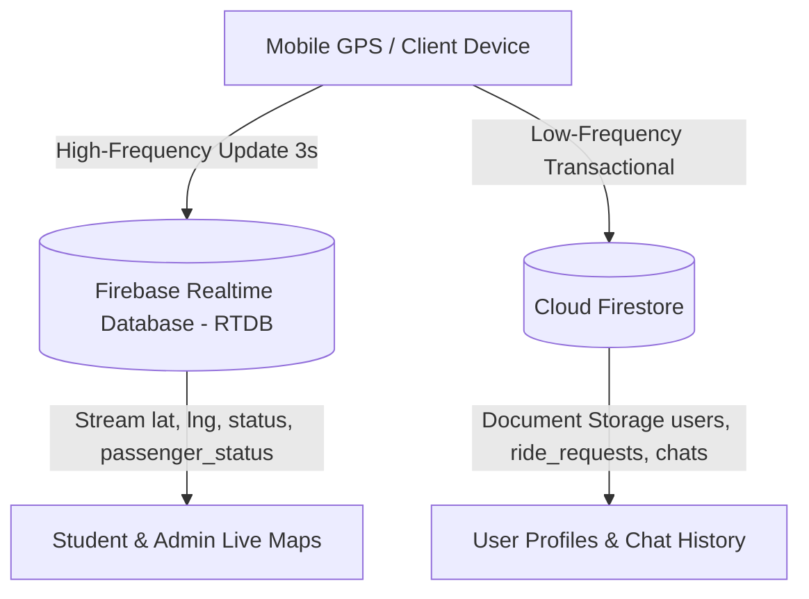

# 📝 PSRU Shuttle App - Detailed System & Feature Documentation (Changelog)

เอกสารฉบับนี้รวบรวมรายละเอียดของระบบ ทั้งในส่วนของฟีเจอร์ โครงสร้างสถาปัตยกรรม (Architecture), ฐานข้อมูล (Database), ลอจิกอัลกอริทึมทางคณิตศาสตร์ (Mathematical Algorithms) และระบบซิงก์ข้อมูลแบบ Real-time ของแอปพลิเคชัน **PSRU Shuttle App** ไว้อย่างสมบูรณ์

---

## 🆕 อัปเดตล่าสุด (Recent Updates)

### Version 1.0.1+2
- **Web App Deployment**: บิลด์และดีพลอยแอปพลิเคชันขึ้น Firebase Hosting
- อัปเดตเวอร์ชันแอปพลิเคชันใน pubspec.yaml เป็น `1.0.1+2`

**อัปเดตระบบแจ้งเตือน (In-App Notifications & Real-Time Sync)**
- **ยกเลิกการใช้ Firebase Cloud Messaging (FCM) & Push Notifications:** ปิดการใช้งานระบบ Push Notification (FCM) แบบเดิมที่เคยทำงานร่วมกับ Cloud Functions ทั้งหมด เพื่อลดความซับซ้อนของโครงสร้างระบบ และหลีกเลี่ยงปัญหาความเข้ากันได้ (Compatibility) บน Web Browser / PWA
- **เปลี่ยนกลับมาใช้ In-App Real-Time Notifications:** ใช้ระบบ Stream (Listen) จาก Cloud Firestore และ Realtime Database แทน เพื่อสร้างการแจ้งเตือนแบบ In-App (Custom Floating Popup / Top Toast) ลอยขึ้นมาบนหน้าจอขณะที่ใช้งานแอปอยู่ ซึ่งตอบสนองได้รวดเร็วกว่าและทำงานได้เสถียรบนทุกแพลตฟอร์ม
- **การแจ้งเตือนเสียงข้ามสิทธิ์:** ยังคงรักษาฟีเจอร์การแจ้งเตือนด้วยเสียง (Sound Alerts & TTS) สำหรับการเรียกรถ การตอบรับ และแชทใหม่ ไว้ได้อย่างสมบูรณ์ผ่านการทำงานเบื้องหน้า (Foreground)

**อัปเดตระบบเส้นทางและ GPS (Routing & GPS Optimization)**
- **Smart Hybrid Routing (Driver App):** ปรับจูนระบบฝั่งคนขับให้บังคับใช้ **Lookahead Window คาดการณ์ล่วงหน้า 3 ป้าย** เป็นหลัก พร้อมกำหนดกฎเหล็กให้ **Recovery Mode ห้ามกระโดดข้ามเกิน 3 ป้าย** (แก้ไขปัญหา GPS คลาดเคลื่อนแล้วทำให้สถานะกระโดดข้ามจากป้าย 12 ไป 18 ในบริเวณทางแยก)
- **Auto-Arrive System (Student App):** ปรับปรุงระบบปิดงานเรียกรถอัตโนมัติ โดยรถจะต้องเดินทางมาถึง "ป้ายเป้าหมายสุดท้ายจริง ๆ" (`stepCount == 0`) และมีระยะห่างน้อยกว่า 15 เมตรเท่านั้น ถึงจะปิดงาน ป้องกันระบบปิดงานก่อนกำหนดเมื่อรถขับผ่านป้ายเป้าหมายในรอบก่อนหน้า
- **Dijkstra Algorithm & Map Nodes:** แก้ไขการสร้างกราฟถนน (`_routeGraph`) ให้รองรับเส้นทางเดินรถแบบ One-Way และแก้ปัญหาคีย์พิกัดสูญหาย รวมถึงปรับพิกัดทางแยก (Segment 14, 15, 23) ใน `route_data.dart` ให้จุดตัดเชื่อมต่อกันอย่างสมบูรณ์แบบ
- **One-Way Route Fallback (Student App):** ดักจับเคสหาเส้นทางบนถนนเดินรถทางเดียว (One-Way) หากรถขับเลยป้ายและอัลกอริทึม (Dijkstra) ไม่สามารถลากเส้นย้อนศรได้ ระบบจะข้ามการลากเส้นตรงทะลุตึกเพื่อรออัปเดตพิกัดใหม่ ป้องกันแผนที่พัง
- **Stop Wrapping Logic:** ปรับจูนระบบกระโดดข้ามป้าย (Jump) ทั้งฝั่งคนขับและนักศึกษา กำหนดขีดจำกัดข้ามไปข้างหน้าสูงสุด 2 ป้าย / ย้อนหลังสูงสุด 1 ป้าย และบังคับการวนลูปจากป้าย 23 ไปยังป้าย 1 เท่านั้น (ห้ามข้ามไป 2 หรือ 3)
- **Firebase Realtime Database (RTDB):** เพิ่มการตั้งค่า `database.rules.json` สำหรับกำหนดสิทธิ์ความปลอดภัยให้รองรับการรับส่ง GPS สด
- **Login Navigation Fix:** แก้ไขบั๊กการเปลี่ยนหน้า (Redirect) ผิดพลาดใน `login_screen.dart` ที่ทำให้เด้งไปหน้าแชทผิดจังหวะ

**อัปเดตส่วนติดต่อผู้ใช้งาน (UI/UX Improvements)**
- **Dynamic Shuttle Naming:** อัปเดตป๊อปอัปแจ้งเตือน (Top Toast) ให้แสดงชื่อและเบอร์รถ (เช่น `รถเบอร์ SH#01`) ที่นักศึกษากำลังสื่อสารด้วย แทนคำว่า "คันเป้าหมาย" เพื่อความชัดเจนและเจาะจง
- **Consistent Chat Popup Design:** ปรับดีไซน์ป๊อปอัปแจ้งเตือนแชทฝั่งนักศึกษา ให้เข้ากับฝั่งคนขับ (ใช้ไอคอนรูปโปรไฟล์วงกลม, เปลี่ยน Label เป็น "คนขับรถ", และทำปุ่มแชทสีขาวตัวอักษรเขียว)
- **Expandable Info Card (Student App):** เพิ่มฟีเจอร์ปุ่ม "ขยายการ์ดข้อมูล" เหนือปุ่มเป้าเล็ง GPS โดยจะแสดงขึ้นมาเฉพาะตอนที่นักศึกษาย่อการ์ดจุดหมายลงไป ทำให้สามารถเรียกการ์ดข้อมูลจุดจอดกลับมาดูแบบเต็มจอได้สะดวกยิ่งขึ้น

---

## 🚀 ฟีเจอร์ที่พัฒนาเสร็จแล้ว (Completed Features)

### 🔐 1. ระบบยืนยันตัวตนและจัดการสิทธิ์ (Authentication & Role Management)
- [x] **การเลือกสิทธิ์การใช้งาน (Multi-Role Signup):** แบ่งเป็นสิทธิ์นักศึกษา (`student`) และคนขับรถ (`driver`)
- [x] **การลงทะเบียนคนขับรถ:** สามารถเลือกรถรับส่งที่ตนเองรับผิดชอบ (เช่น `Shuttle #01`, `Shuttle #02`) พร้อมเลือกรูปโปรไฟล์ Avatar
- [x] **เชื่อมต่อ Firebase Authentication:** ตรวจสอบอีเมลและรหัสผ่าน ป้องกันการเข้าถึงหน้าจอที่ไม่ได้รับอนุญาต
- [x] **จัดเก็บโปรไฟล์ใน Firestore:** บันทึกข้อมูลลงในคอลเล็กชัน `users`
- [x] **ระบบการออกจากระบบ (Logout):** ล้าง State และคืนสิทธิ์อย่างปลอดภัยทั้งบนแอปมือถือและเว็บ

### 🧑‍🎓 2. ฝั่งนักศึกษา (Student Portal)
- [x] **แผนที่ติดตามรถแบบ Real-time (Live Map Tracking):** แสดงตำแหน่งรถทุกคันที่กำลังออนไลน์บน OpenStreetMap ด้วย `flutter_map`
- [x] **ระบบคำนวณเส้นทางไฮไลท์อัจฉริยะ (Smart Route Highlighting):** ลากเส้นสีเขียวเข้มไฮไลท์เส้นทางสั้นที่สุดจากจุดที่รถอยู่ไปยังป้ายที่เลือก
- [x] **ระบบเรียกรถรับส่ง (Ride Request):** นักศึกษากดเรียกรถล่วงหน้า คนขับจะได้รับเสียงเตือนและป๊อปอัปแจ้งเตือนบนหน้าจอทันที
- [x] **ระบบติดตามสถานะการขึ้นรถ (On-Board Tracking):** อัปเดตสถานะเป็น `acknowledged` -> `on_board` -> `completed`
- [x] **จุดจอดที่ชอบ (Favorite Stops):** ติดดาวป้ายรถเมล์ที่ใช้ประจำเพื่อจัดให้อยู่ด้านบนสุดของรายการ
- [x] **แชทกับคนขับรถ (Student-Driver Chat):** ส่งข้อความและรูปภาพสื่อสารกับคนขับประจำสายแบบ Real-time พร้อมป๊อปอัปแจ้งเตือนลอยด้านบน
- [x] **หน้าสรุปสถานะรถสด (Live Status Dashboard):** การ์ดแสดงจำนวนรถว่าง, รถเต็ม, พักเบรค, นอกเวลา แบบ 2x2 Grid ตอบสนองทุกขนาดหน้าจอ

### 🚌 3. ฝั่งคนขับรถ (Driver Portal)
- [x] **สวิตช์เปิด/ปิดสถานะวิ่งรถ (Online/Offline Toggle):** ซิงก์ตำแหน่ง GPS อัตโนมัติไปยัง Firebase Realtime Database (RTDB)
- [x] **ระบบล็อกหมุดบนถนน (Snap to Route Algorithm):** บังคับหมุดรถให้อยู่บนถนนจริงเสมอ ไม่ลอยเข้าไปในอาคาร
- [x] **การแจ้งเตือนเสียงจุดจอดอัตโนมัติ (TTS & Sound Alerts):** อ่านชื่อจุดจอดภาษาไทยทั้ง 21 ป้ายด้วยระบบ Text-to-Speech (`flutter_tts`) ร่วมกับเสียงเอฟเฟกต์ `chat_sound.mp3`, `glass_1.mp3`, `glass_2.mp3`
- [x] **ป๊อปอัปการ์ดแจ้งเตือนข้อความแชตใหม่ (Driver Chat Popup Card):** แสดงการ์ดลอยด้านบนเมื่อนักศึกษาทักแชต พร้อมปุ่มกดตอบกลับทันที
- [x] **สลับสถานะผู้โดยสาร (Passenger Status):** อัปเดตสถานะรถเป็น "รถว่าง", "รถเต็ม", "เวลาพักเบรค", "เลิกงาน"

### 👑 4. ฝั่งผู้ดูแลระบบ (Admin Master Dashboard)
- [x] **แดชบอร์ดสถิติ Real-Time (Live Analytics Dashboard):** คำนวณผู้โดยสารรวมประจำวัน, ชั่วโมงที่มีการใช้งานสูงสุด (Peak Hour), จำนวนเที่ยววิ่ง
- [x] **กราฟจำลองผู้โดยสารประจำวัน (24-Hour Passenger Distribution Chart):** วาดกราฟเส้นโค้งจำลองปริมาณผู้โดยสาร 24 ชั่วโมงด้วย Custom Painter
- [x] **แผนที่ติดตามกองรถสด (Admin Live Fleet Map):** ยุบกลุ่มป้ายที่อยู่ใกล้กัน (`_groupedStops`) และติดตามรถทุกคันพร้อมสถิติสด
- [x] **ระบบจัดการคนขับและนักศึกษา (User Management):** ค้นหา, กรองสถานะออนไลน์, เพิ่ม/แก้ไข/ลบ ข้อมูลสมาชิก

---

## 🧠 อธิบาย Logic และ Algorithm สำคัญ (Core Architecture & Mathematical Logic)

---

### 1. ⚡ สถาปัตยกรรมฐานข้อมูลแบบไฮบริด (Hybrid RTDB + Firestore Architecture)

> [!NOTE]
> เพื่อแก้ไขปัญหาความล่าช้า (Latency) และประหยัดโควต้าการอ่าน/เขียนของ Firebase (Quota & Cost Optimization) โปรเจกต์นี้จึงใช้สถาปัตยกรรมฐานข้อมูลแบบผสม 2 ชนิด:



1. **Firebase Realtime Database (RTDB) — โหนด `shuttles/{shuttle_id}`**:
   - ใช้สำหรับข้อมูลที่มีการอัปเดตความถี่สูงทุกๆ 3 วินาที ได้แก่ พิกัดละติจูด (`lat`), ลองจิจูด (`lng`), สถานะออนไลน์ (`status`), สถานะผู้โดยสาร (`passenger_status`) และเวลาล่าสุด (`last_updated`)
   - ช่วยให้หมุดรถลื่นไหลแบบ 60fps และไม่เสียโควต้า Document Reads/Writes ใน Firestore
2. **Cloud Firestore — คอลเล็กชัน `users`, `ride_requests`, `chats`, `stops`**:
   - ใช้สำหรับข้อมูลเชิงความสัมพันธ์ เช่น ประวัติคำขอเรียกรถ, บัญชีผู้ใช้, จุดจอดที่ชอบ และข้อความแชทสนทนา

> 💡 **สรุปแบบเข้าใจง่าย (สำหรับบุคคลทั่วไป / ไม่ใช่สายไอที):**  
> เปรียบเหมือน **"ระบบส่งข้อมูล 2 ช่องทาง (ช่องทางด่วน + ตู้เซฟหลัก)"**
> - **ช่องทางด่วน (Realtime DB):** เหมือนใช้วิทยุสื่อสารรายงานตำแหน่งรถสดๆ ทุก 3 วินาที ทำให้หมุดรถบนหน้าจอขยับลื่นไหล ไม่กระตุก และลื่นตามาก
> - **ตู้เซฟหลัก (Cloud Firestore):** เหมือนตู้เซฟเก็บประวัติสำคัญ เช่น ข้อมูลสมาชิกนักศึกษา ประวัติคำขอเรียกรถ และข้อความแชท เพื่อความปลอดภัยและประหยัดค่าบริการเซิร์ฟเวอร์

---

### 2. 📍 อัลกอริทึมล็อกหมุดบนถนน (Snap to Route Algorithm via Vector Orthogonal Projection)

> [!TIP]
> แก้ไขปัญหาสัญญาณ GPS คลาดเคลื่อน (GPS Drift) ที่ทำให้หมุดกระโดดเข้าไปในอาคารเรียน โดยการใช้หลักคณิตศาสตร์ **Vector Projection** บนเส้นทางถนน (`shuttleRoutes`)

$$t = \frac{\vec{AP} \cdot \vec{AB}}{|\vec{AB}|^2} = \frac{(p_x - a_x)(b_x - a_x) + (p_y - a_y)(b_y - a_y)}{(b_x - a_x)^2 + (b_y - a_y)^2}$$

1. **การหาจุดตั้งฉากบนส่วนของเส้นตรง (Segment Projection):**
   - ให้จุด $P = (p_x, p_y)$ เป็นพิกัด GPS ดิบจากมือถือคนขับ
   - ให้ $A = (a_x, a_y)$ และ $B = (b_x, b_y)$ เป็นจุดปลายของส่วนของเส้นตรงถนน (Polyline Segment)
   - คำนวณค่าสเกลาร์ $t$ (Normalized Projection Parameter) ผ่านผลคูณจุด (Dot Product) ตามสูตรด้านบน
2. **การบีบขอบเขตจุดฉาย (Clamping Bounds):**
   - ถ้า $t < 0 \implies C = A$ (ยึดจุดเริ่มต้น)
   - ถ้า $t > 1 \implies C = B$ (ยึดจุดปลาย)
   - ถ้า $0 \le t \le 1 \implies C = \left( a_x + t(b_x - a_x), \; a_y + t(b_y - a_y) \right)$ (จุดตั้งฉากบนถนน)
3. **การเลือกจุดที่ใกล้ที่สุดและการเคลื่อนไหวแบบนุ่มนวล (Minimum Distance & Smooth Interpolation):**
   - คำนวณระยะทางกำลังสอง $D^2 = (p_x - c_x)^2 + (p_y - c_y)^2$ เปรียบเทียบทุก Segment เพื่อเลือกจุด $C_{\text{min}}$ บนถนนที่ใกล้ที่สุด
   - เคลื่อนหมุดไปยังพิกัดใหม่ด้วย `AnimationController` (Duration 400ms) ร่วมกับ `Tween<LatLng>` และ `Curves.easeInOut` เพื่อให้หมุดเลื่อนตามโค้งถนนอย่างลื่นไหล

> 💡 **สรุปแบบเข้าใจง่าย (สำหรับบุคคลทั่วไป / ไม่ใช่สายไอที):**  
> เปรียบเหมือน **"แม่เหล็กดูดรถเข้าเส้นทางถนน"**
> - สัญญาณ GPS จากมือถือคนขับมักจะคลาดเคลื่อนเวลามีตึกบัง ทำให้หมุดรถชอบลอยหลุดเข้าไปในตึกเรียนหรือบนหลังคาอาคาร
> - ระบบนี้จะทำหน้าที่เป็นเหมือน **"แม่เหล็กคอยดูดตำแหน่งรถให้ตกลงบนเส้นทางถนนจริงเสมอ"** ไม่ว่ารถจะเลี้ยวโค้งหรือเข้าทางแยก หมุดรถก็จะวิ่งอยู่บนถนนอย่างสมจริง ไร้อาการหลุดเข้าไปในตึก

---

### 3. 🗺️ อัลกอริทึมคำนวณเส้นทางไฮไลท์และเวลาถึงป้าย (Smart Proximity Pathfinding & Dijkstra's ETA)

> [!IMPORTANT]
> ระบบคำนวณเส้นทางอัจฉริยะใน `student_home.dart` มีการตรวจสอบระยะทางตรงจริง (Direct Proximity Check) ร่วมกับ Dijkstra Algorithm เพื่อป้องกันการลากเส้นวนรอบมหาวิทยาลัย

1. **Smart Direct Proximity Check (ตรวจจับระยะประชิด):**
   - คำนวณระยะทางตรง $\text{Direct Distance}$ ระหว่างพิกัดรถใกล้ที่สุดกับป้ายเป้าหมาย
   - **กรณีระยะทาง $\le 80 \text{ เมตร}$:** ระบบจะเชื่อมเส้นไฮไลท์ไปยังป้ายทันที โดยไม่วนลูปป้าย 23 จุดรอบมหาวิทยาลัย พร้อมแสดง ETA ว่า **"รถกำลังจะถึงป้าย"**
2. **Dijkstra Shortest Path บนกราฟถนน (`_routeGraph`):**
   - **กรณีระยะทาง $> 80 \text{ เมตร}$:** ระบบจะนำป้ายตามลำดับ (`order`) มาแทรกเป็น Waypoints แล้วรัน Dijkstra's Algorithm หาเส้นทางสั้นที่สุดบนกราฟถนน Adjacency List
3. **สูตรคำนวณเวลา ETA (Estimated Time of Arrival):**
   $$\text{Total Seconds} = \left( \frac{\text{Total Road Meters}}{7.0} \right) + 15.0$$
   - ความเร็วเฉลี่ย $7.0 \text{ m/s}$ ($\approx 25.2 \text{ km/h}$) + บัฟเฟอร์ชะลอรับส่ง $15 \text{ วินาที}$
   - ป้ายข้อความ ETA ลอยขึ้นบนพิกัดกึ่งกลางเส้นทาง (`_getPathMidpoint()`) บนแผนที่

> 💡 **สรุปแบบเข้าใจง่าย (สำหรับบุคคลทั่วไป / ไม่ใช่สายไอที):**  
> เปรียบเหมือน **"ระบบเนวิเกเตอร์ฉลาดเลือกทางลัด + นาฬิกาบอกเวลาล่วงหน้า"**
> - **ฉลาดรู้ว่าใกล้ถึงแล้ว:** เมื่อนักศึกษากดเลือกป้ายรถเมล์ ถ้ารถรับส่งอยู่ใกล้ป้ายนั้นแล้ว แอปจะรู้ทันทีว่า "กำลังจะถึง" โดยลากเส้นตรงไปหาป้ายเลย ไม่ลากเส้นวนรอบมหาวิทยาลัยให้สับสน
> - **คำนวณเวลารอ:** ระบบจะวัดความยาวถนนและประเมินความเร็วรถ แล้วคำนวณออกมาเป็นตัวเลขอ่านง่าย เช่น *"อีกประมาณ 3 นาทีจะถึงป้าย"* ทำให้นักศึกษากะเวลาเดินมารอรถได้อย่างแม่นยำ

---

### 4. 🔔 ระบบแจ้งเตือนแชทและป๊อปอัปข้ามสิทธิ์ (Cross-Role Real-Time Floating Popup & Audio System)

1. **การ์ดแจ้งเตือนลอยด้านบน (Top Floating Notification Banner):**
   - ออกแบบการ์ดสไตล์ Glassmorphism โทนสีเขียวเข้ม Gradient (`#176a21` ไป `#0F4D17`) พร้อมขอบขาวโปร่งใส เงาสายนุ่มนวล
   - เว้นระยะ Safe Area คำนวณรอยบากหน้าจอ (Notch) อัตโนมัติ
2. **การทำงานข้ามสิทธิ์ (Cross-Role Integration):**
   - **เมื่อคนขับส่งข้อความ:** นักศึกษาจะได้รับป๊อปอัปแจ้งเตือนพร้อมไอคอนรถ 🚌 และปุ่ม **"แชท/ตอบกลับ"** สลับไปหน้าแชตคันนั้นทันที
   - **เมื่อนักศึกษาส่งข้อความ:** คนขับจะได้รับป๊อปอัปแจ้งเตือนพร้อมป้ายแท็ก `นักศึกษา` และปุ่ม **"ตอบกลับ"** สลับไปหน้าแชตทันที
3. **ไฟล์เสียงและระบบเสียงแจ้งเตือน (Audio Asset & TTS System):**
   - `chat_sound.mp3`: เสียงแจ้งเตือนข้อความแชทใหม่ (ทั้งฝั่งนักศึกษาและคนขับ)
   - `glass_1.mp3`: เสียงแจ้งเตือนเมื่อนักศึกษากดเรียกรถ
   - `glass_2.mp3`: เสียงแจ้งเตือนเมื่อนักศึกษาลงรถ
   - **Text-to-Speech Engine (`flutter_tts`)**: อ่านชื่อจุดจอดภาษาไทยสดแบบไดนามิกทั้ง 21 ป้าย (รวมถึงการแจ้งเตือนนักศึกษารอ/ลงรถ) โดยไม่ต้องใช้ไฟล์ MP3 สำเร็จรูป

> 💡 **สรุปแบบเข้าใจง่าย (สำหรับบุคคลทั่วไป / ไม่ใช่สายไอที):**  
> เปรียบเหมือน **"วิทยุสื่อสารด่วนพร้อมป๊อปอัปเด้งบนหน้าจอ"**
> - เมื่อนักศึกษากดเรียกรถ หรือคนขับพิมพ์ทักแชตหา หน้าจอของอีกฝั่งจะมี **ป๊อปอัปการ์ดเด้งขึ้นมาจากขอบบนสุดของหน้าจอ** พร้อมเสียงแจ้งเตือนเฉพาะตัว (เสียงแชต / เสียงเรียกรถ)
> - สามารถกดปุ่ม **"ตอบกลับ"** บนการ์ดเพื่อเปิดเข้าสู่ห้องแชทได้ทันที โดยไม่ต้องเสียเวลางมหาเมนู

---

### 5. 📱 ระบบการ์ดสรุปสถานะแบบเรสพอนซีฟ (Auto-Responsive Equal Height Layout)

1. **คณิตศาสตร์คำนวณความสูงคงที่ใน `StudentLiveStatusScreen`:**
   - ใช้ `LayoutBuilder` คำนวณความกว้างการ์ดย่อย `itemWidth = (constraints.maxWidth - 16) / 2`
   - กำหนดความสูงเป้าหมาย `targetHeight = 88.0` พิกเซล
   - คำนวณอัตราส่วน `childAspectRatio = itemWidth / targetHeight`
   - ผลลัพธ์: การ์ดสถานะทั้ง 4 ใบ (รถว่าง, รถเต็ม, พักเบรค, นอกเวลา) มีความสูง 88px เท่ากันพอดีทุกใบ สมส่วน ไร้พื้นที่ว่างส่วนเกิน บนมือถือ แท็บเล็ต และเว็บเดสก์ท็อป

> 💡 **สรุปแบบเข้าใจง่าย (สำหรับบุคคลทั่วไป / ไม่ใช่สายไอที):**  
> เปรียบเหมือน **"กล่องยืดหยุ่น พอดีตัวทุกหน้าจอ"**
> - ไม่ว่าจะเปิดดูแอปด้วยมือถือจอเล็ก มือถือจอใหญ่ ไอแพด แท็บเล็ต หรือเปิดบนจอคอมพิวเตอร์
> - กล่องสรุปสถานะรถว่าง/รถเต็มทั้ง 4 กล่อง จะปรับขนาดความกว้างและความสูงให้เท่ากันพอดี 88 พิกเซลทุกใบเสมอ ตัวหนังสือและไอคอนจะจัดเรียงสวยงาม ไร้อาการเบี้ยว ทับซ้อน หรือตกขอบ

---

### 6. ☁️ สถาปัตยกรรมคลาวด์ฟังก์ชันและการแจ้งเตือน (Cloud Functions & Push Notifications)

> [!TIP]
> ระบบแจ้งเตือน Notification ในโปรเจกต์นี้ใช้ **Firebase Cloud Functions** เป็น Backend ประมวลผลกลาง เพื่อให้ส่งแจ้งเตือนข้ามแพลตฟอร์มได้อย่างเสถียรและเป็นระบบอัตโนมัติ 

1. **Firestore Triggers (Event-Driven Backend):**
   - **ระบบเรียกรถ (`ride_requests`):** คลาวด์ฟังก์ชันตั้ง Trigger `onUpdate` คอยเฝ้าระวังเมื่อสถานะเปลี่ยนแปลง เช่น เมื่อคนขับกดยอมรับ (`acknowledged`) หรือเมื่อคนขับยกเลิกงาน ระบบจะดึง `fcmToken` ของนักศึกษาจากคอลเล็กชัน `users` แล้วสั่งยิง Push Notification แจ้งเตือนสถานะรถทันที
   - **ระบบแชท (`chats`):** คลาวด์ฟังก์ชันตั้ง Trigger `onCreate` ดักจับเมื่อมีข้อความแชทใหม่ หากข้อความถูกส่งจากคนขับไปยังนักศึกษา ระบบจะดึง token แล้วยิงแจ้งเตือน Notification ไปยังหน้าจอมือถือนักศึกษาโดยอัตโนมัติ
2. **การทำงานเบื้องหลัง (Background vs Foreground):**
   - ใช้ **Firebase Cloud Messaging (FCM)** ในการยิงข้อความผ่านโครงข่ายของ Google/Apple
   - เมื่อข้อความมาถึงแอปในขณะที่แอปถูกปิด (Background) ระบบ OS จะนำไปแสดงที่ Notification Center หรือหน้าจอล็อก (Lock Screen) ทันที
   - เมื่อข้อความมาถึงขณะที่เปิดแอปอยู่ (Foreground) แพ็กเกจ `flutter_local_notifications` จะเข้ามาทำหน้าที่สร้างป๊อปอัปแจ้งเตือน (Heads-up Notification) ลอยเหนือหน้าจอแอปแบบอัตโนมัติ

> 💡 **สรุปแบบเข้าใจง่าย (สำหรับบุคคลทั่วไป / ไม่ใช่สายไอที):**  
> เปรียบเหมือน **"โอเปอเรเตอร์อัตโนมัติ 24 ชั่วโมง"**
> - ในระบบแบบเก่า ถ้าคนขับจะบอกนักศึกษาว่า "กำลังไปรับนะ" มือถือคนขับจะต้องออกแรงส่งข้อมูลไปหามือถือนักศึกษาเอง (ซึ่งอาจล้มเหลวถ้าเน็ตฝั่งคนขับหลุด)
> - ระบบใหม่นี้ เราสร้าง **"หุ่นยนต์บนคลาวด์" (Cloud Functions)** ให้นั่งเฝ้าฐานข้อมูลกลาง เมื่อไหร่ก็ตามที่หุ่นยนต์เห็นว่าคนขับกดรับงาน มันจะทำหน้าที่ชงเรื่องและส่งข้อความ Push เด้งไปหามือถือนักศึกษาด้วยตัวเองทันที ทำให้ระบบมีความแม่นยำและเสถียรระดับสากล

---

## 🛠️ โครงสร้างไฟล์ในโปรเจกต์ (Project Directory Structure)

```
lib/
├── firebase_options.dart            # การตั้งค่า Firebase สำหรับแต่ละแพลตฟอร์ม
├── main.dart                        # Entry point ของแอปพลิเคชัน & ระบบ Routing
├── route_data.dart                  # ข้อมูลพิกัดเวกเตอร์เส้นทางถนน และลอจิกสร้างกราฟ
├── screens/
│   ├── login_screen.dart            # หน้าเข้าสู่ระบบ
│   ├── register_screen.dart         # หน้าสมัครสมาชิก (แยก Role & Avatar)
│   ├── forgot_password_screen.dart  # หน้าลืมรหัสผ่าน
│   ├── admin/                       # แดชบอร์ดผู้ดูแลระบบ
│   │   ├── admin_dashboard.dart     # แดชบอร์ดหลัก & กราฟผู้โดยสาร 24 ชั่วโมง
│   │   ├── admin_live_map.dart      # แผนที่ติดตามกองรถสด
│   │   ├── admin_analytics_tab.dart # แท็บวิเคราะห์ข้อมูลสถิติ
│   │   ├── admin_drivers_tab.dart   # จัดการข้อมูลคนขับรถ
│   │   ├── admin_students_tab.dart  # จัดการข้อมูลนักศึกษา
│   │   ├── add_driver_dialog.dart   # ไดอะล็อกเพิ่มคนขับ
│   │   ├── add_student_dialog.dart  # ไดอะล็อกเพิ่มนักศึกษา
│   │   ├── edit_driver_dialog.dart  # ไดอะล็อกแก้ไขคนขับ
│   │   └── edit_student_dialog.dart # ไดอะล็อกแก้นักศึกษา
│   ├── driver/                      # ระบบฝั่งคนขับรถ
│   │   ├── driver_home.dart         # หน้าหลักคนขับ (Snap to Route, Audio Alerts, Chat Popup)
│   │   ├── driver_chat_screen.dart  # หน้าแชทสนทนากับนักศึกษา
│   │   ├── driver_profile.dart      # หน้าโปรไฟล์คนขับ
│   │   ├── driver_status_screen.dart# หน้าสลับสถานะที่นั่งรถ
│   │   └── driver_edit_profile_screen.dart # หน้าแก้ไขข้อมูลส่วนตัว
│   └── student/                     # ระบบฝั่งนักศึกษา
│       ├── student_home.dart        # หน้าหลักนักศึกษา (Live Map, Pathfinding, ETA, Chat Popup)
│       ├── student_chat_list_screen.dart # หน้ารวมรายการห้องแชทรถทุกคัน (แสดงสถานะจุดเขียว)
│       ├── student_chat_screen.dart # หน้าห้องแชทกับคนขับประจำคัน
│       ├── student_live_status_screen.dart # หน้าสรุปสถานะรถสด (Responsive Equal Height Grid)
│       ├── student_profile.dart     # หน้าโปรไฟล์นักศึกษา
│       ├── favorite_stops_screen.dart # หน้าจัดการจุดจอดที่ติดดาว
│       ├── student_edit_profile_screen.dart # หน้าแก้ไขโปรไฟล์
│       └── student_onboarding_screen.dart   # หน้าแนะนำการใช้งานเริ่มต้น
└── widgets/
    └── top_toast.dart               # วิดเจ็ตแจ้งเตือนข้อความสั้น (Toast)
```

---

## 🎨 การเปลี่ยนไอคอนแอป (App Launcher Icon)

โปรเจกต์ได้รับการกำหนดค่า package `flutter_launcher_icons` เรียบร้อยแล้ว โดยใช้รูปภาพรถรับส่ง PSRU Green Bus 3D High-Res (`lib/screens/driver/screen.png`):

```bash
flutter pub get
dart run flutter_launcher_icons
```

---

## 📦 รายการ API, ไลบรารี (Packages & Libraries) และเทคโนโลยีที่ใช้ในโปรเจกต์

### 🌐 1. APIs & Web Services (บริการเว็บเอพีไอและคลาวด์)
- **OpenStreetMap Tile API (`https://tile.openstreetmap.org/{z}/{x}/{y}.png`)**: API ให้บริการแผนที่ดาวเทียม/ถนนแบบเปิด (Open Source Raster Tiles) สำหรับแสดงผลแผนที่มหาวิทยาลัยราชภัฏพิบูลสงครามบน `flutter_map`
- **Firebase Authentication API**: ระบบยืนยันตัวตนผู้ใช้ จัดเก็บและตรวจสอบสิทธิ์เข้าใช้งานของผู้ใช้ (นักศึกษา / คนขับรถ / ผู้ดูแลระบบ)
- **Firebase Realtime Database (RTDB) API**: บริการฐานข้อมูล Key-Value ความเร็วสูง ซิงก์ข้อมูลพิกัดละติจูด-ลองจิจูด สถานะออนไลน์ และสถานะที่นั่งของรถรับส่งแบบ Real-time ผ่าน WebSocket / Data Streams
- **Cloud Firestore Database API**: บริการฐานข้อมูล NoSQL Document สเกลสูง จัดเก็บและซิงก์ข้อมูลบัญชีผู้ใช้ (`users`), คำขอเรียกรถ (`ride_requests`), ประวัติข้อความแชท (`chats`), และจุดจอดรถ (`stops`)
- **Firebase Storage API**: บริการจัดเก็บไฟล์สื่อ (Cloud Storage) สำหรับอัปโหลดและดึงรูปภาพโปรไฟล์ Avatar และรูปภาพสื่อสารในห้องแชท
- **Geolocator Native Location API**: API บริการพิกัดตำแหน่งอุปกรณ์ (Android Location Provider / iOS CoreLocation / Web HTML5 Geolocation API) เพื่อดึงพิกัด GPS ปัจจุบันของนักศึกษาและคนขับรถ

---

### 📚 2. Flutter Libraries & Packages (ไลบรารีและแพ็กเกจหลักใน `pubspec.yaml`)

#### ☁️ ฐานข้อมูลและสถาปัตยกรรมคลาวด์ (Firebase & Cloud Packages)
- **`firebase_core` (^3.12.0)**: แพ็กเกจตั้งค่าและเริ่มต้นการทำงานของบริการ Firebase ในแอปพลิเคชัน
- **`cloud_firestore` (^5.6.5)**: จัดการฐานข้อมูล Document สำหรับข้อมูลผู้ใช้, คำขอเรียกรถ, และแชท
- **`firebase_database` (^11.3.1)**: จัดการเชื่อมต่อและฟังการเปลี่ยนแปลงพิกัดตำแหน่งรถแบบ Real-time บน RTDB
- **`firebase_auth` (^5.5.1)**: บริการล็อกอิน, สมัครสมาชิก, เปลี่ยนรหัสผ่าน และจัดการ Auth Session
- **`firebase_storage` (^12.4.4)**: อัปโหลดและดึง URL รูปภาพโปรไฟล์และรูปภาพห้องแชท
- **`firebase_messaging` (^15.x)**: รับส่งและจัดการข้อความ Push Notification จากเซิร์ฟเวอร์แบบเบื้องหลัง (Background)
- **`flutter_local_notifications` (^17.x - 22.x)**: สร้างการแจ้งเตือนแบบ Heads-up ลอยบนหน้าจอเมื่อกำลังเปิดแอป (Foreground) และจัดการ Notification Channels ของระบบ OS

#### 🗺️ แผนที่และคณิตศาสตร์ทางภูมิศาสตร์ (Map & Geographic Math Packages)
- **`flutter_map` (^7.0.2)**: วิดเจ็ตแผนที่ OpenStreetMap แบบ Interactive รองรับการแสดงหมุด (Markers), เส้นโพลีไลน์ (Polylines), และการควบคุมกล้อง
- **`latlong2` (^0.9.1)**: ไลบรารีคำนวณคณิตศาสตร์ทางภูมิศาสตร์ เช่น พิกัด `LatLng` และคำนวณระยะห่างระหว่างพิกัดด้วยสูตร Geodesic Distance

#### 📍 การจัดการตำแหน่ง GPS และอุปกรณ์ (Location & Device Packages)
- **`geolocator` (^13.0.2)**: ดึงพิกัด GPS ปัจจุบัน ตรวจสอบสิทธิ์การเข้าถึงตำแหน่ง (Location Permission) และฟังการเปลี่ยนแปลงตำแหน่งเคลื่อนที่

#### 🔊 เสียงและการแจ้งเตือน (Audio & Sound Packages)
- **`audioplayers` (^6.1.0)**: เล่นไฟล์เสียงแจ้งเตือน Custom MP3 ในแอปพลิเคชัน เช่น เสียงแชตใหม่ (`chat_sound.mp3`) และเสียงเรียกรถ/ลงรถ (`glass_1.mp3`, `glass_2.mp3`)
- **`flutter_ringtone_player` (^3.2.0)**: เล่นเสียงกระดิ่ง/เสียงแจ้งเตือนเริ่มต้นของระบบอุปกรณ์
- **`flutter_tts` (^4.2.0)**: ระบบแปลงข้อความเป็นเสียงพูด (Text-to-Speech Engine) สำหรับอ่านชื่อป้ายจอดภาษาไทยสดแบบไดนามิกทั้ง 21 ป้าย

#### 📱 อินเทอร์เฟซผู้ใช้และมัลติมีเดีย (UI, Media & Tutorial Packages)
- **`tutorial_coach_mark` (^1.2.11)**: แสดงหน้าจอสอนแนะนำการใช้งานเริ่มต้น (Step-by-step Interactive Tutorial) ด้วยแสง Highlight Spotlight และการ์ดคำอธิบาย
- **`image_picker` (^1.1.2)**: เลือกและถ่ายรูปภาพจากกล้องหรือคลังภาพในเครื่อง (Gallery) เพื่อตั้งโปรไฟล์หรือส่งในห้องแชท
- **`shared_preferences` (^2.5.2)**: บันทึกข้อมูลการตั้งค่าเบาๆ ในเครื่อง เช่น สถานะเคยดู Tutorial (`hasSeenTutorial`), การค้างล็อกอิน
- **`intl` (^0.20.2)**: จัดการฟอร์แมตวันที่ เวลา (Timestamp) และตัวเลขภาษาไทย/สากล
- **`cupertino_icons` (^1.0.8)**: ชุดไอคอนมาตรฐานสไตล์ iOS/macOS

#### 🛠️ เครื่องมือพัฒนา (Dev Tools)
- **`flutter_launcher_icons` (^0.14.3)**: เครื่องมือสร้างไอคอนแอป (App Launcher Icons) อัตโนมัติสำหรับทุกแพลตฟอร์ม (Android, iOS, Web)

---

### ⚙️ 3. เทคโนโลยี โครงสร้างพื้นฐาน และทรัพยากรอื่นๆ (Other Infrastructure & Assets)
- **Flutter SDK 3.x & Dart 3.x**: โครงสร้างการพัฒนาแอปพลิเคชันแบบ Cross-Platform (Android, iOS, Web Desktop/Mobile) ด้วย Material Design 3
- **Audio & Graphic Assets**:
  - ไฟล์เสียง MP3 ใน `assets/voice/` สำหรับจุดจอดรถ 21 ป้าย และไฟล์เสียงแจ้งเตือนข้อความ/เรียกรถ
  - ไฟล์รูปภาพ 3D Bus Image High-Res ใน `lib/screens/driver/screen.png` สำหรับสร้างไอคอนแอป
- **Haptic Feedback System (`HapticFeedback.heavyImpact()`)**: สั่นตอบสนองทางกายภาพบนมือถือเมื่อกดปุ่มเรียกรถหรือตอบรับผู้โดยสาร
- **Custom Painter Framework**: วาดกราฟสถิติผู้โดยสาร 24 ชั่วโมงสดบน Master Admin Dashboard
